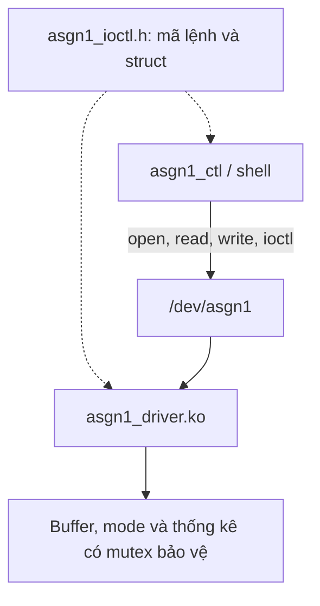

# Assignment 01 — IOCTL and Miscellaneous Device Drivers

[Về trang chính](../README.md) · [Task 1](task1_ioctl/) · [Task 2](task2_misc/) · [Log](logs/) · [Báo cáo PDF](bao_cao/SE201095_PhamTranGiaLong_Asgn01_BaoCao.pdf)

Asgn1 mở rộng kiến thức character driver của Lab 02 bằng giao diện **IOCTL**, ứng dụng điều khiển từ userspace và một **counter driver dùng miscdevice**. Source, Makefile, module ARM, test script và bằng chứng chạy được lưu cùng nhau.

## Nội dung

- [Mục tiêu và tổ chức](#mục-tiêu-và-tổ-chức)
- [Task 1 — IOCTL driver](#task-1--ioctl-driver)
- [Task 2 — Counter miscdevice](#task-2--counter-miscdevice)
- [Build trên HOST](#build-trên-host)
- [Kiểm thử trên ARM target](#kiểm-thử-trên-arm-target)
- [Bằng chứng và phân tích](#bằng-chứng-và-phân-tích)
- [Kinh nghiệm thực hiện](#kinh-nghiệm-thực-hiện)

## Mục tiêu và tổ chức

| Đường dẫn | Nội dung |
|---|---|
| [task1_ioctl/asgn1_driver.c](task1_ioctl/asgn1_driver.c) | Character driver và callback IOCTL |
| [task1_ioctl/asgn1_ioctl.h](task1_ioctl/asgn1_ioctl.h) | ABI dùng chung giữa driver và userspace |
| [task1_ioctl/asgn1_ctl.c](task1_ioctl/asgn1_ctl.c) | Chương trình điều khiển IOCTL |
| [task1_ioctl/test_asgn1.sh](task1_ioctl/test_asgn1.sh) | Kiểm thử Task 1 |
| [task2_misc/counter_driver.c](task2_misc/counter_driver.c) | Miscdevice, counter và procfs |
| [task2_misc/test_counter.sh](task2_misc/test_counter.sh) | Kiểm thử Task 2 |
| [logs/](logs/) | Test output và kernel log |
| [bao_cao/](bao_cao/) | Phân tích thiết kế và báo cáo |

Môi trường: Ubuntu HOST, ARM GNU Toolchain 13.2.1, Linux target 5.15.0 và QEMU Cortex-A9. Thư mục Task 2 trong repository là **`task2_misc`**; một số log gốc dùng tên làm việc `task2_counter`.

## Task 1 — IOCTL driver



Driver giữ dữ liệu trong kernel và cho userspace điều khiển bằng bốn lệnh. Header dùng magic `'G'` và version buffer 64 byte.

| Lệnh | Hướng dữ liệu | Chức năng |
|---|---|---|
| `ASGN1_RESET_BUFFER` | `_IO` | Xóa buffer và reset các thống kê đọc/ghi liên quan |
| `ASGN1_GET_STATS` | `_IOR` | Trả `open_count`, `write_count`, `read_count`, `buffer_len`, `last_write_size` |
| `ASGN1_SET_MODE` | `_IOW` | Nhận `int`: 0 = kernel mode; 1 = echo mode |
| `ASGN1_GET_VERSION` | `_IOR` | Trả chuỗi version trong vùng 64 byte |

Callback dùng `copy_from_user`/`copy_to_user` khi trao đổi dữ liệu. Lỗi truy cập vùng nhớ trả `-EFAULT`; mode không hợp lệ trả `-EINVAL`; lệnh không hỗ trợ trả `-ENOTTY`.

Lệnh điều khiển trên target sau khi module và node `/dev/asgn1` đã sẵn sàng:

```sh
asgn1_ctl version
asgn1_ctl reset
asgn1_ctl stats
asgn1_ctl mode 1
printf 'Hello Asgn1\n' > /dev/asgn1
cat /dev/asgn1
asgn1_ctl stats
```

Mỗi lần chạy `asgn1_ctl` có thao tác open/close thiết bị; cần tính tới điều đó khi đọc `open_count`.

## Task 2 — Counter miscdevice

| Giao diện | Hành vi |
|---|---|
| `/dev/counter` read | Trả giá trị counter; logic đọc và EOF kiểm soát việc tăng counter |
| `/dev/counter` write | Nhận số nguyên không âm để đặt counter |
| `/proc/counter_info` | Xuất counter, `total_reads` và `total_writes` |
| sysfs misc class | Cho phép quan sát thiết bị được đăng ký qua miscdevice |

Test kiểm tra chuỗi đọc 0, 1, 2; đặt giá trị 10; từ chối `-1` và `abc`; reset về 0; unload và xác nhận các giao diện được dọn dẹp. Bài yêu cầu xử lý EOF/partial read đúng, tránh coi mỗi đoạn đọc của cùng một giá trị là một phép đọc counter độc lập.

## Build trên HOST

Từ thư mục `Asgn1`:

```bash
# Thay đường dẫn bằng source kernel đã configure/build cho target của bạn.
make -C task1_ioctl KDIR="$HOME/embedded_lab1/kernel/linux-5.15"
make -C task2_misc KDIR="$HOME/embedded_lab1/kernel/linux-5.15"

arm-none-linux-gnueabihf-gcc -static -O2 -Wall -Wextra \
    task1_ioctl/asgn1_ctl.c -o task1_ioctl/asgn1_ctl

file task1_ioctl/asgn1_driver.ko task1_ioctl/asgn1_ctl \
    task2_misc/counter_driver.ko
```

Hai Makefile dùng `ARCH=arm` và prefix `arm-none-linux-gnueabihf-`. `KDIR` là đường dẫn source/build kernel, không phải thư mục chỉ chứa `zImage`. Kết quả `.ko` cần khớp kernel đang chạy trong QEMU.

## Kiểm thử trên ARM target

Task 1/2 được chạy trong rootfs ARM đã cài module, ứng dụng điều khiển và test script. Thư mục Asgn1 trên GitHub tập trung vào source và bằng chứng; rootfs của phiên làm việc không được giả định đã nằm trong image Lab 01.

Các bước chuẩn bị trên HOST:

1. Build hai module và `asgn1_ctl`.
2. Cài `.ko` vào `/lib/modules/5.15.0/` của rootfs ARM.
3. Cài `asgn1_ctl`, `test_asgn1.sh` và `test_counter.sh` vào `/usr/bin/` của rootfs.
4. Đóng gói initramfs, rồi boot bằng kernel/DTB tương thích từ Lab 01.

Trong shell QEMU đã chuẩn bị, có thể chạy test qua `sh`:

```sh
uname -r
sh /usr/bin/test_counter.sh
sh /usr/bin/test_asgn1.sh
dmesg | tail -n 40
```

Đọc nội dung script trước khi chạy để biết điều kiện module ban đầu. Một số test tự load/unload module và có điểm dừng để chụp màn hình. Không load module thêm lần nữa nếu script đang quản lý vòng đời đó.

## Bằng chứng và phân tích

| Tài liệu | Dùng để kiểm tra |
|---|---|
| [Task 1 output](logs/test_asgn1_output.txt) | Các lệnh IOCTL, đọc/ghi và kết quả Task 1 |
| [Counter output](logs/test_counter_output.txt) | Trạng thái counter, input không hợp lệ và cleanup |
| [Kernel log](logs/dmesg_full.txt) | Hoạt động module và thông báo kernel |
| [Báo cáo PDF](bao_cao/SE201095_PhamTranGiaLong_Asgn01_BaoCao.pdf) | Giải thích thiết kế, đồng bộ, IOCTL và phần phân tích lý thuyết |

Theo README gốc của gói nộp, phiên sau sửa kết thúc lúc 13:01:26 (+07:00), ngày 21/10/2026: cả hai script in PASSED và có exit status 0. Một log test PASS thể hiện các điều kiện được script kiểm tra trong phiên đó. Khi chỉnh source, cần build lại, thay module trong rootfs, đóng gói image và chạy test lại để bằng chứng khớp bản code cuối.

## Kinh nghiệm thực hiện

- Header IOCTL phải thống nhất giữa userspace và kernel; sai struct hoặc kích thước có thể làm hỏng ABI.
- Không đọc trực tiếp con trỏ userspace trong kernel.
- Một biến counter atomic không tự làm cho mọi nhóm thống kê trở thành một snapshot nhất quán.
- Phân biệt EOF, partial read và lần mở thiết bị mới khi thiết kế callback read.
- Cleanup phải bao gồm procfs, sysfs và đăng ký device; test unload cần kiểm tra cả các đường dẫn đó.
- Lỗi build được xử lý từ thông báo compiler và đoạn source liên quan; build xong vẫn cần kiểm tra runtime.
