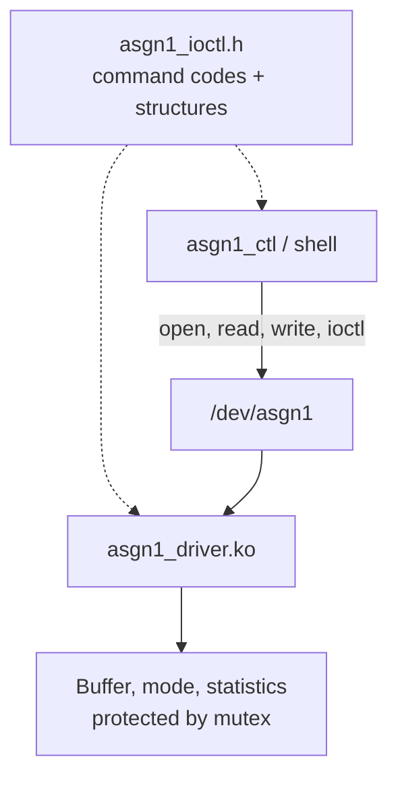

# Assignment 01 — IOCTL and Miscellaneous Device Drivers

[Back to Main Page](../README.md) · [Task 1](task1_ioctl/) · [Task 2](task2_misc/) · [Logs](logs/) · [PDF Report](report/SE201095_PhamTranGiaLong_Asgn01_BaoCao.pdf)

Assignment 01 extends the character-driver concepts from Lab 02 by introducing an **IOCTL interface**, a userspace control application, and a **counter driver implemented with miscdevice**.

This README is written as both a project overview and a practical implementation guide: how to build, integrate, test, diagnose failures, and verify the final result.

---

## Table of Contents

- [Objectives and Project Organization](#objectives)
- [Prerequisites](#prerequisites)
- [Task 1 — IOCTL Driver](#task1)
- [Task 2 — Counter Miscdevice](#task2)
- [Step-by-Step Build Guide](#build-guide)
- [Installing into the ARM Root Filesystem](#install-rootfs)
- [Running on QEMU ARM](#run-qemu)
- [Testing Task 1](#test-task1)
- [Testing Task 2](#test-task2)
- [Common Errors and Fixes](#errors)
- [How to Find Where the Failure Is](#debug-flow)
- [Verification Checklist](#checklist)
- [Evidence and Analysis](#evidence)
- [Lessons Learned](#lessons)

---

<a id="objectives"></a>
## Objectives and Project Organization

| Path | Description |
|---|---|
| [task1_ioctl/asgn1_driver.c](task1_ioctl/asgn1_driver.c) | Character driver and IOCTL callbacks |
| [task1_ioctl/asgn1_ioctl.h](task1_ioctl/asgn1_ioctl.h) | Shared ABI between the driver and userspace |
| [task1_ioctl/asgn1_ctl.c](task1_ioctl/asgn1_ctl.c) | Userspace IOCTL control application |
| [task1_ioctl/test_asgn1.sh](task1_ioctl/test_asgn1.sh) | Task 1 test script |
| [task2_misc/counter_driver.c](task2_misc/counter_driver.c) | Miscdevice counter driver and procfs interface |
| [task2_misc/test_counter.sh](task2_misc/test_counter.sh) | Task 2 test script |
| [logs/](logs/) | Test outputs and kernel logs |
| [report/](report/) | Design analysis and PDF report |

### Environment Used

- Ubuntu HOST
- ARM GNU Toolchain 13.2.1
- Linux 5.15.0 target kernel
- QEMU `vexpress-a9`
- Cortex-A9 / ARMv7-A

> HOST commands are executed on Ubuntu x86_64.  
> TARGET commands are executed inside QEMU ARM.

---

<a id="prerequisites"></a>
## Prerequisites

Before building Assignment 01, verify that the Lab 01 kernel source and ARM toolchain are available.

### Check the cross compiler

```bash
arm-none-linux-gnueabihf-gcc --version
```

Expected: ARM GNU Toolchain output.

If the command is not found:

```bash
export PATH=/path/to/arm-gnu-toolchain/bin:$PATH
```

Then check again.

### Check the Linux kernel source

```bash
ls "$HOME/embedded_lab1/kernel/linux-5.15"
```

Important files/directories should include:

```text
Makefile
arch/
drivers/
include/
scripts/
```

### Check whether the kernel was configured

```bash
test -f "$HOME/embedded_lab1/kernel/linux-5.15/.config" \
    && echo "Kernel configured" \
    || echo "Kernel .config missing"
```

If `.config` is missing, the module build will usually fail.

---

<a id="task1"></a>
## Task 1 — IOCTL Driver



The driver stores data in kernel space and allows userspace control through four IOCTL commands.

| Command | Direction | Function |
|---|---|---|
| `ASGN1_RESET_BUFFER` | `_IO` | Clears the buffer and resets related statistics |
| `ASGN1_GET_STATS` | `_IOR` | Returns open/write/read counters and buffer information |
| `ASGN1_SET_MODE` | `_IOW` | Receives mode: 0 = kernel mode, 1 = echo mode |
| `ASGN1_GET_VERSION` | `_IOR` | Returns the driver version string |

### Why the shared header matters

The kernel driver and userspace program must use the **same IOCTL numbers and structures**.

If `asgn1_ioctl.h` differs between them, the ioctl call may return:

```text
Inappropriate ioctl for device
```

or may transfer incorrect data.

---

<a id="task2"></a>
## Task 2 — Counter Miscdevice

| Interface | Behavior |
|---|---|
| `/dev/counter` read | Returns the current counter value |
| `/dev/counter` write | Accepts a non-negative integer to set/reset the counter |
| `/proc/counter_info` | Displays counter value and read/write statistics |
| miscdevice sysfs entry | Shows the registered miscdevice |

The implementation must correctly handle:

- EOF
- partial reads
- invalid strings
- negative values
- repeated device opens
- cleanup during module unload

---

<a id="build-guide"></a>
## Step-by-Step Build Guide

### Step 1 — Build Task 1 kernel module

From the `Asgn1` directory:

```bash
make -C task1_ioctl \
    KDIR="$HOME/embedded_lab1/kernel/linux-5.15"
```

Check the output:

```bash
ls -lh task1_ioctl/asgn1_driver.ko
file task1_ioctl/asgn1_driver.ko
```

Expected architecture:

```text
ELF 32-bit LSB relocatable, ARM
```

### Step 2 — Build Task 2 kernel module

```bash
make -C task2_misc \
    KDIR="$HOME/embedded_lab1/kernel/linux-5.15"
```

Verify:

```bash
ls -lh task2_misc/counter_driver.ko
file task2_misc/counter_driver.ko
```

Expected:

```text
ELF 32-bit LSB relocatable, ARM
```

### Step 3 — Build the userspace control program

```bash
arm-none-linux-gnueabihf-gcc \
    -static -O2 -Wall -Wextra \
    task1_ioctl/asgn1_ctl.c \
    -o task1_ioctl/asgn1_ctl
```

Verify architecture:

```bash
file task1_ioctl/asgn1_ctl
```

Expected:

```text
ELF 32-bit LSB executable, ARM
```

### Step 4 — Verify all build products together

```bash
file \
    task1_ioctl/asgn1_driver.ko \
    task1_ioctl/asgn1_ctl \
    task2_misc/counter_driver.ko
```

If one of the files reports `x86-64`, it was built with the HOST compiler by mistake.

---

<a id="install-rootfs"></a>
## Installing into the ARM Root Filesystem

Assume the ARM root filesystem is available at:

```text
/path/to/rootfs
```

Create the target module directory if necessary:

```bash
mkdir -p /path/to/rootfs/lib/modules/5.15.0
```

Copy the modules:

```bash
cp task1_ioctl/asgn1_driver.ko \
   /path/to/rootfs/lib/modules/5.15.0/

cp task2_misc/counter_driver.ko \
   /path/to/rootfs/lib/modules/5.15.0/
```

Copy userspace tools and tests:

```bash
cp task1_ioctl/asgn1_ctl \
   /path/to/rootfs/usr/bin/

cp task1_ioctl/test_asgn1.sh \
   /path/to/rootfs/usr/bin/

cp task2_misc/test_counter.sh \
   /path/to/rootfs/usr/bin/
```

Set execute permission:

```bash
chmod +x \
    /path/to/rootfs/usr/bin/asgn1_ctl \
    /path/to/rootfs/usr/bin/test_asgn1.sh \
    /path/to/rootfs/usr/bin/test_counter.sh
```

### Verify before repacking

```bash
ls -lh /path/to/rootfs/lib/modules/5.15.0/
ls -lh /path/to/rootfs/usr/bin/asgn1_ctl
ls -lh /path/to/rootfs/usr/bin/test_asgn1.sh
ls -lh /path/to/rootfs/usr/bin/test_counter.sh
```

If you rebuild a module but forget to copy it into the rootfs, QEMU will continue running the old version.

---

<a id="run-qemu"></a>
## Running on QEMU ARM

Boot using the kernel, DTB, and initramfs produced from the same target environment.

Inside QEMU, first verify the target:

```sh
uname -a
uname -r
```

Expected kernel:

```text
5.15.0
```

Mount runtime filesystems if your initramfs does not do this automatically:

```sh
mkdir -p /proc /sys /tmp
mount -t proc proc /proc
mount -t sysfs sysfs /sys
chmod 1777 /tmp
```

Check modules:

```sh
ls /lib/modules/$(uname -r)/
```

---

<a id="test-task1"></a>
## Testing Task 1

### Manual load

```sh
insmod /lib/modules/$(uname -r)/asgn1_driver.ko
```

Check:

```sh
lsmod
dmesg | tail -n 30
ls -l /dev/asgn1
```

If the device node exists, test the control application:

```sh
asgn1_ctl version
asgn1_ctl reset
asgn1_ctl stats
asgn1_ctl mode 1
```

Test read/write:

```sh
printf 'Hello Asgn1\n' > /dev/asgn1
cat /dev/asgn1
```

Check statistics again:

```sh
asgn1_ctl stats
```

### Automated test

If the script manages module load/unload itself, unload any manually loaded copy first:

```sh
rmmod asgn1_driver 2>/dev/null
```

Then run:

```sh
sh /usr/bin/test_asgn1.sh
echo "exit=$?"
```

Expected:

```text
PASSED
exit=0
```

---

<a id="test-task2"></a>
## Testing Task 2

If the test script manages module lifecycle, run:

```sh
rmmod counter_driver 2>/dev/null
sh /usr/bin/test_counter.sh
echo "exit=$?"
```

Expected:

```text
PASSED
exit=0
```

For manual inspection:

```sh
insmod /lib/modules/$(uname -r)/counter_driver.ko

ls -l /dev/counter
cat /proc/counter_info
```

Read the counter:

```sh
cat /dev/counter
cat /dev/counter
cat /dev/counter
```

Test setting a value:

```sh
echo 10 > /dev/counter
cat /dev/counter
```

Test invalid input:

```sh
echo -1 > /dev/counter
echo abc > /dev/counter
```

Inspect kernel messages:

```sh
dmesg | tail -n 50
```

---

<a id="errors"></a>
## Common Errors and Fixes

### 1. `No such file or directory` when building the module

Typical cause:

```text
KDIR points to the wrong directory
```

Check:

```bash
ls "$HOME/embedded_lab1/kernel/linux-5.15/Makefile"
```

Fix: use the real configured kernel source directory.

---

### 2. `No rule to make target modules`

Cause: the kernel source was not configured/prepared.

Check:

```bash
ls "$HOME/embedded_lab1/kernel/linux-5.15/.config"
```

Possible fix:

```bash
cd "$HOME/embedded_lab1/kernel/linux-5.15"

make ARCH=arm CROSS_COMPILE=arm-none-linux-gnueabihf- olddefconfig
make ARCH=arm CROSS_COMPILE=arm-none-linux-gnueabihf- prepare
make ARCH=arm CROSS_COMPILE=arm-none-linux-gnueabihf- modules_prepare
```

---

### 3. `Exec format error`

Example:

```text
-sh: ./asgn1_ctl: Exec format error
```

Cause: x86_64 binary copied into ARM rootfs.

Check on HOST:

```bash
file task1_ioctl/asgn1_ctl
```

Fix: rebuild using the ARM cross compiler.

---

### 4. `invalid module format`

Check:

```sh
dmesg | tail -n 30
uname -r
modinfo /lib/modules/$(uname -r)/asgn1_driver.ko 2>/dev/null
```

Typical causes:

- module built for another kernel version
- module built using a different kernel configuration
- wrong architecture

Fix: rebuild the `.ko` using the exact kernel source/configuration used by QEMU.

---

### 5. `/dev/asgn1` or `/dev/counter` does not exist

First check whether the module loaded:

```sh
lsmod
dmesg | tail -n 50
```

If module load failed, fix that first.

If module loaded but device is missing:

```sh
ls -l /dev
```

Then inspect the driver registration code and `dmesg`.

---

### 6. `Inappropriate ioctl for device`

Typical causes:

- wrong IOCTL number
- userspace and driver use different headers
- ioctl callback is not registered

Check:

```bash
grep -R "ASGN1_" task1_ioctl/
```

Both `asgn1_driver.c` and `asgn1_ctl.c` should include the same `asgn1_ioctl.h`.

---

### 7. `Permission denied`

Check:

```sh
ls -l /dev/asgn1 /dev/counter
```

Temporary test:

```sh
chmod 666 /dev/asgn1
chmod 666 /dev/counter
```

For a real system, permissions should be managed more carefully.

---

### 8. `Device or resource busy`

Cause: the module is still in use.

Check:

```sh
lsmod
```

Close any process using the device, then retry:

```sh
rmmod asgn1_driver
```

---

### 9. Test script fails although manual test works

Run the script with shell tracing:

```sh
sh -x /usr/bin/test_asgn1.sh
```

or:

```sh
sh -x /usr/bin/test_counter.sh
```

This shows the exact command that fails.

---

### 10. QEMU still behaves like the old code

Most common reason: the module was rebuilt on HOST but the rootfs/initramfs still contains the previous `.ko`.

Check the timestamp before repacking:

```bash
ls -lh task1_ioctl/asgn1_driver.ko
ls -lh /path/to/rootfs/lib/modules/5.15.0/asgn1_driver.ko
```

Copy again and rebuild the initramfs.

---

<a id="debug-flow"></a>
## How to Find Where the Failure Is

Use this sequence instead of guessing:

```text
1. Did the source compile?
       |
       +-- NO --> compiler error / KDIR / toolchain
       |
       +-- YES
            |
2. Is the binary/module ARM?
       |
       +-- NO --> wrong compiler
       |
       +-- YES
            |
3. Is the new file really inside the rootfs?
       |
       +-- NO --> copy/repack problem
       |
       +-- YES
            |
4. Does QEMU boot the expected kernel?
       |
       +-- NO --> wrong zImage/initramfs
       |
       +-- YES
            |
5. Does insmod succeed?
       |
       +-- NO --> dmesg / kernel mismatch / driver init
       |
       +-- YES
            |
6. Does /dev or /proc appear?
       |
       +-- NO --> registration problem
       |
       +-- YES
            |
7. Does manual read/write/ioctl work?
       |
       +-- NO --> callback logic / ABI problem
       |
       +-- YES
            |
8. Does the test script pass?
       |
       +-- NO --> run script with sh -x
       |
       +-- YES --> PASS
```

Useful commands:

```sh
uname -r
lsmod
dmesg | tail -n 80
ls -l /dev/asgn1 /dev/counter
cat /proc/counter_info 2>/dev/null
```

---

<a id="checklist"></a>
## Verification Checklist

Before considering Assignment 01 complete:

- [ ] `asgn1_driver.ko` is ARM
- [ ] `counter_driver.ko` is ARM
- [ ] `asgn1_ctl` is ARM
- [ ] Modules match Linux 5.15 target kernel
- [ ] `/dev/asgn1` appears after loading Task 1
- [ ] IOCTL version/reset/stats/mode commands work
- [ ] Read/write through `/dev/asgn1` works
- [ ] `/dev/counter` appears after loading Task 2
- [ ] `/proc/counter_info` works
- [ ] Invalid counter values are rejected
- [ ] Task 1 script prints `PASSED`
- [ ] Task 2 script prints `PASSED`
- [ ] Test scripts return exit status `0`
- [ ] Module unload removes the corresponding interfaces
- [ ] Final logs correspond to the final source version

---

<a id="evidence"></a>
## Evidence and Analysis

| Document | Purpose |
|---|---|
| [Task 1 Output](logs/test_asgn1_output.txt) | IOCTL commands, read/write operations, Task 1 results |
| [Counter Output](logs/test_counter_output.txt) | Counter state, invalid input handling, cleanup |
| [Kernel Log](logs/dmesg_full.txt) | Kernel module activity and kernel messages |
| [PDF Report](report/SE201095_PhamTranGiaLong_Asgn01_BaoCao.pdf) | Design explanation and analysis |

Recorded test evidence shows that both scripts reached `PASSED` and returned exit status `0`.

---

<a id="lessons"></a>
## Lessons Learned

- Keep kernel/userspace IOCTL definitions in one shared header.
- Never directly dereference userspace pointers from kernel code.
- Distinguish compile-time, module-load, interface-registration, and runtime failures.
- Always verify architecture using `file`.
- Always inspect `dmesg` after a failed `insmod`.
- Repack the rootfs/initramfs after replacing modules.
- A clean build is not enough; runtime verification on ARM is still required.
