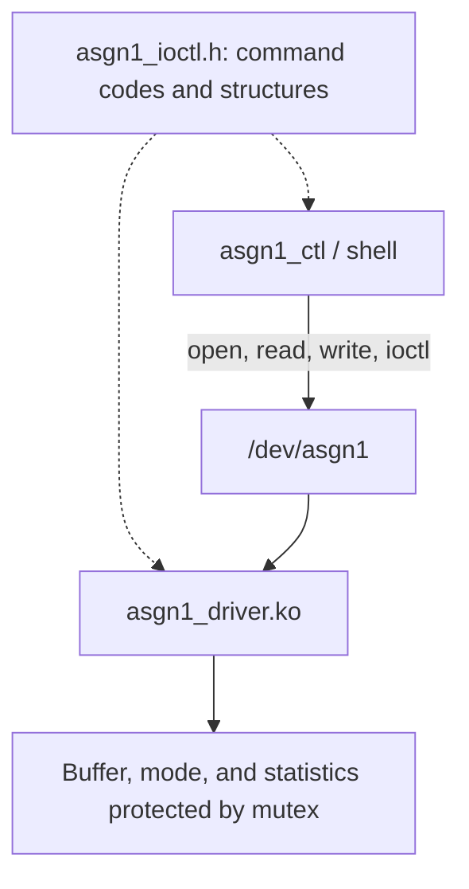

# Assignment 01 — IOCTL and Miscellaneous Device Drivers

[Back to Main Page](../README.md) · [Task 1](task1_ioctl/) · [Task 2](task2_misc/) · [Logs](logs/) · [PDF Report](bao_cao/SE201095_PhamTranGiaLong_Asgn01_BaoCao.pdf)

Assignment 01 extends the character driver concepts from Lab 02 by introducing the IOCTL interface, a userspace control application, and a counter driver implemented with `miscdevice`.

The repository stores the source code, Makefiles, ARM kernel modules, test scripts, and execution evidence together.

## Table of Contents

- [Objectives and Project Organization](#objectives-and-project-organization)
- [Task 1 — IOCTL Driver](#task-1--ioctl-driver)
- [Task 2 — Counter Miscdevice](#task-2--counter-miscdevice)
- [Building on the HOST](#building-on-the-host)
- [Testing on the ARM Target](#testing-on-the-arm-target)
- [Evidence and Analysis](#evidence-and-analysis)
- [Lessons Learned](#lessons-learned)

## Objectives and Project Organization

| Path | Description |
| --- | --- |
| [asgn1_driver.c](task1_ioctl/asgn1_driver.c) | Character driver and IOCTL callbacks |
| [asgn1_ioctl.h](task1_ioctl/asgn1_ioctl.h) | Shared ABI between the driver and userspace |
| [asgn1_ctl.c](task1_ioctl/asgn1_ctl.c) | Userspace IOCTL control application |
| [test_asgn1.sh](task1_ioctl/test_asgn1.sh) | Task 1 test script |
| [counter_driver.c](task2_misc/counter_driver.c) | Miscdevice counter driver and procfs interface |
| [test_counter.sh](task2_misc/test_counter.sh) | Task 2 test script |
| [logs/](logs/) | Test outputs and kernel logs |
| [bao_cao/](bao_cao/) | Design analysis and PDF report |

**Environment:**

- Ubuntu HOST
- ARM GNU Toolchain 13.2.1
- Linux 5.15.0 target kernel
- QEMU Cortex-A9

> **Note:** The Task 2 directory in the repository is named `task2_misc`. Some original logs may still use the earlier working name `task2_counter`.

## Task 1 — IOCTL Driver



The driver stores data in kernel space and allows userspace control through four IOCTL commands.
The shared header uses the magic value `'G'` and a 64-byte version buffer.

| Command | Direction | Function |
| --- | --- | --- |
| `ASGN1_RESET_BUFFER` | `_IO` | Clears the buffer and resets the related read/write statistics |
| `ASGN1_GET_STATS` | `_IOR` | Returns `open_count`, `write_count`, `read_count`, `buffer_len`, and `last_write_size` |
| `ASGN1_SET_MODE` | `_IOW` | Receives an `int`: `0` = kernel mode, `1` = echo mode |
| `ASGN1_GET_VERSION` | `_IOR` | Returns the driver version string in a 64-byte buffer |

The callbacks use `copy_from_user()` and `copy_to_user()` to transfer data between userspace and kernel space.

**Error handling:**

- Invalid userspace memory access returns `-EFAULT`.
- Invalid mode values return `-EINVAL`.
- Unsupported IOCTL commands return `-ENOTTY`.

Example commands on the ARM target after the module and `/dev/asgn1` device node are ready:

```bash
asgn1_ctl version
asgn1_ctl reset
asgn1_ctl stats
asgn1_ctl mode 1

printf 'Hello Asgn1\n' > /dev/asgn1
cat /dev/asgn1
asgn1_ctl stats
```

Each execution of `asgn1_ctl` performs an open/close operation on the device. Therefore, this behavior must be considered when interpreting the `open_count` statistic.

## Task 2 — Counter Miscdevice

| Interface | Behavior |
| --- | --- |
| `/dev/counter` read | Returns the current counter value; read and EOF logic controls when the counter is incremented |
| `/dev/counter` write | Accepts a non-negative integer to set the counter value |
| `/proc/counter_info` | Displays the current counter, `total_reads`, and `total_writes` |
| misc sysfs class | Allows observation of the device registered through `miscdevice` |

**The test verifies:**

- Sequential reads of `0`, `1`, and `2`
- Setting the counter to `10`
- Rejection of invalid inputs such as `-1` and `abc`
- Resetting the counter to `0`
- Module unload
- Cleanup of the corresponding interfaces

The assignment requires correct EOF and partial-read handling so that multiple partial reads of the same value are not incorrectly treated as separate counter reads.

## Building on the HOST

From the `Asgn1` directory:

```bash
# Replace the path with the kernel source/build directory
# configured for the ARM target.
make -C task1_ioctl \
    KDIR="$HOME/embedded_lab1/kernel/linux-5.15"

make -C task2_misc \
    KDIR="$HOME/embedded_lab1/kernel/linux-5.15"

arm-none-linux-gnueabihf-gcc \
    -static -O2 -Wall -Wextra \
    task1_ioctl/asgn1_ctl.c \
    -o task1_ioctl/asgn1_ctl

file \
    task1_ioctl/asgn1_driver.ko \
    task1_ioctl/asgn1_ctl \
    task2_misc/counter_driver.ko
```

Both Makefiles use:

```makefile
ARCH=arm
CROSS_COMPILE=arm-none-linux-gnueabihf-
```

`KDIR` must point to the configured and built Linux kernel source directory, not to a directory that only contains `zImage`.
The generated `.ko` modules must match the kernel running inside QEMU.

## Testing on the ARM Target

Tasks 1 and 2 are executed inside an ARM root filesystem containing the kernel modules, userspace control application, and test scripts.

The Assignment 01 directory on GitHub focuses on source code and execution evidence. The working root filesystem is not assumed to already be included in the Lab 01 image.

### Preparation on the HOST

1. Build both kernel modules and `asgn1_ctl`.
2. Install the `.ko` modules into `/lib/modules/5.15.0/` in the ARM root filesystem.
3. Install `asgn1_ctl`, `test_asgn1.sh`, and `test_counter.sh` into `/usr/bin/`.
4. Repack the initramfs.
5. Boot QEMU using the compatible Lab 01 kernel and DTB.

### Running the Tests in QEMU

Inside the prepared QEMU shell:

```bash
uname -r
sh /usr/bin/test_counter.sh
sh /usr/bin/test_asgn1.sh

dmesg | tail -n 40
```

The test scripts should be reviewed before execution to understand their expected initial module state.
Some scripts automatically load and unload the kernel modules and may include pause points for taking screenshots. Do not manually load the same module again if the script already manages its lifecycle.

## Evidence and Analysis

| Document | Purpose |
| --- | --- |
| [Task 1 Output](logs/test_asgn1_output.txt) | IOCTL commands, read/write operations, and Task 1 results |
| [Counter Output](logs/test_counter_output.txt) | Counter state, invalid input handling, and cleanup results |
| [Kernel Log](logs/dmesg_full.txt) | Kernel module activity and kernel messages |
| [PDF Report](bao_cao/SE201095_PhamTranGiaLong_Asgn01_BaoCao.pdf) | Design explanation, synchronization, IOCTL implementation, and theoretical analysis |

According to the original README from the submission package, the final corrected execution session ended at **13:01:26 (+07:00) on October 21, 2026**.

Both test scripts printed:

```text
PASSED
```

and returned exit status `0`.

A PASS result demonstrates that the conditions checked by the corresponding test script were satisfied during that execution session.

Whenever the source code is modified, the project should be rebuilt, the updated kernel modules should be copied into the ARM root filesystem, the initramfs should be repacked, and the tests should be executed again so that the saved evidence matches the final source code.

## Lessons Learned

- The IOCTL header must remain consistent between userspace and kernel space. Incorrect structures or sizes can break the ABI.
- Kernel code must never directly dereference userspace pointers.
- `copy_from_user()` and `copy_to_user()` should be used for userspace/kernel data transfer.
- Using an atomic counter does not automatically make a group of statistics a consistent snapshot.
- EOF behavior, partial reads, and new device opens must be treated separately when designing a `read()` callback.
- Cleanup must include procfs entries, sysfs interfaces, and device registration.
- Module unload tests should verify that all corresponding interfaces are removed.
- Build errors should be resolved based on compiler messages and the related source code.
- A successful build must still be followed by runtime verification on the ARM target.
