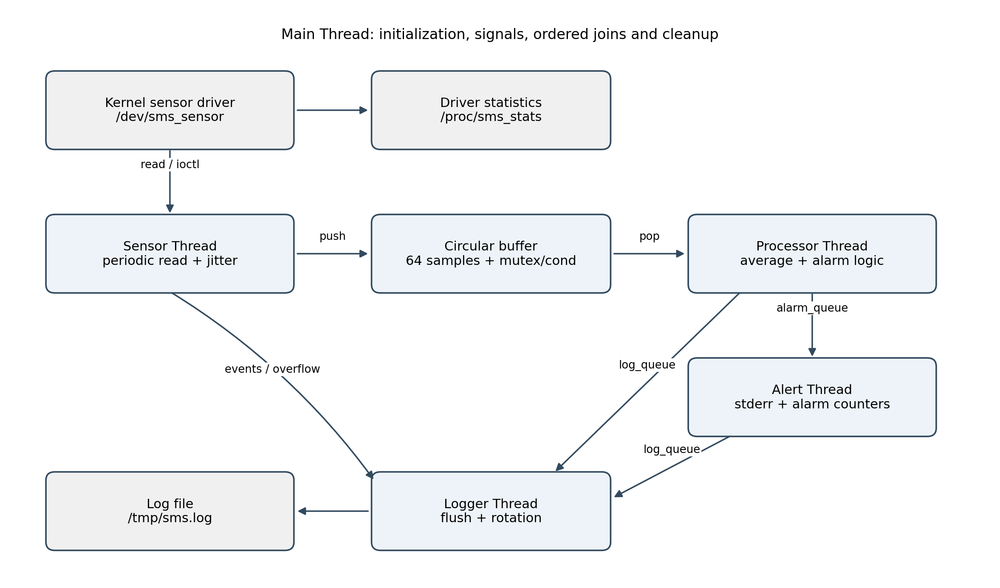

# LOS201 — Sensor Monitoring System / Assignment 02

[Back to Main Page](../README.md) · [Application Source](app/) · [Driver](driver/) · [Logs](logs/) · [PDF Report](bao_cao/SE201095_PhamTranGiaLong_Asgn02_BaoCao.pdf)

A simulated temperature and humidity monitoring system running on Linux ARMv7 in QEMU.

The driver generates a sample when the application performs a read and the minimum interval has elapsed; these are not measurements from a physical sensor. The application uses four worker threads to read, process, generate alerts, and write logs.

## Table of Contents

- [Architecture](#architecture)
- [Driver and Simulated Data](#driver-and-simulated-data)
- [Project Structure](#project-structure)
- [Building on Ubuntu HOST](#building-on-ubuntu-host)
- [Running Diagnostics on the HOST](#running-diagnostics-on-the-host)
- [Running on QEMU ARM](#running-on-qemu-arm)
- [Saved Experimental Results](#saved-experimental-results)
- [Lessons Learned and Fixes](#lessons-learned-and-fixes)
- [Final GDB Session](#final-gdb-session)
- [Report and Submission Status](#report-and-submission-status)

## Architecture



```mermaid
flowchart TD
    D["Kernel
