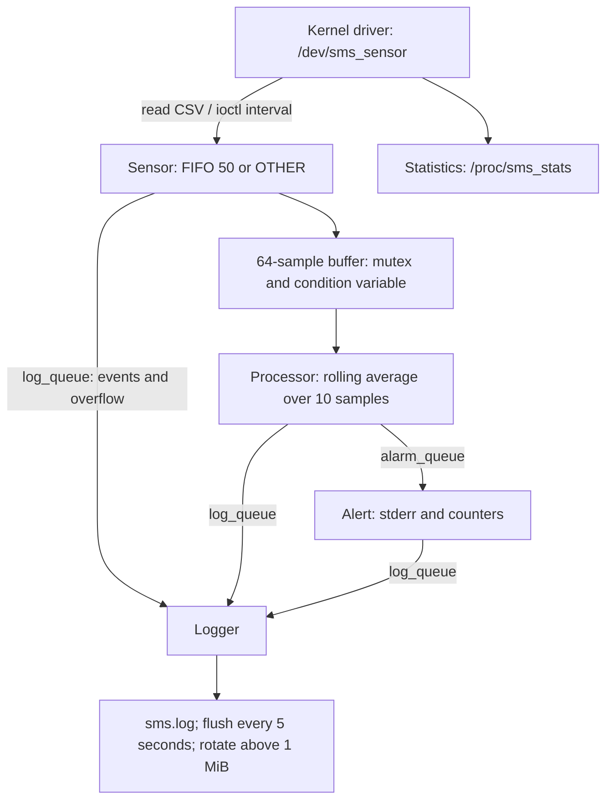
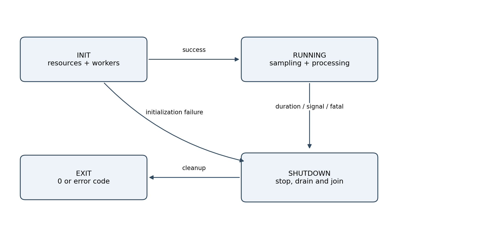
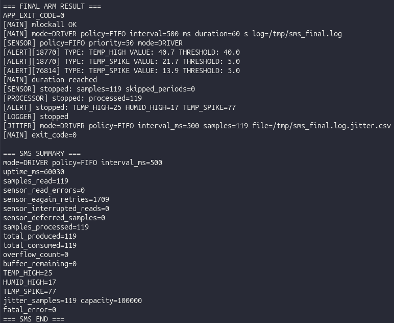
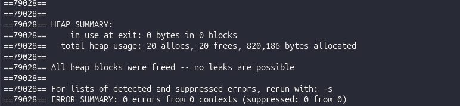

from pathlib import Path

content = r"""# LOS201 — Sensor Monitoring System / Assignment 02

[Back to Main Page](../README.md) · [Application Source](app/) · [Driver](driver/) · [Logs](logs/) · [PDF Report](bao_cao/SE201095_PhamTranGiaLong_Asgn02_BaoCao.pdf)

A simulated temperature and humidity monitoring system running on Linux ARMv7 in QEMU.

The driver generates a sample when the application performs a read and the minimum interval has elapsed; these are not measurements from a physical sensor. The application uses four worker threads to read, process, generate alerts, and write logs.

## Table of Contents

- [Architecture](#architecture)
- [Driver and Simulated Data](#driver-and-simulated-data)
- [Project Structure](#project-structure)
- [Building on Ubuntu HOST](#building-on-ubuntu-host)
- [Running Diagnostics on the HOST](#running-diagnostics-on-the-host)
- [Running on QEMU ARM](#running-on-qemu-arm)
- [Saved Experimental Results](#saved-experimental-results)
- [Lessons Learned and Fixes](#lessons-learned-and-fixes)
- [Final GDB Session](#final-gdb-session)
- [Report and Submission Status](#report-and-submission-status)

## Architecture




Main initializes and joins the workers according to their dependencies.

During a normal shutdown:

- Sensor closes the buffer.
- Processor drains all remaining samples.
- Alert receives all pending alarm messages.
- Logger drains all remaining log messages, flushes the file, and closes it.

`SIGINT` and `SIGTERM` are received by Main using `sigtimedwait`, avoiding mutex operations inside a signal handler.

## Driver and Simulated Data

The `sms_sensor_driver.ko` driver registers the miscdevice `/dev/sms_sensor` and the procfs entry `/proc/sms_stats`.

| Interface | Behavior |
|---|---|
| `read` | Returns CSV containing timestamp in milliseconds, temperature, and humidity |
| Temperature range | 15.0–45.0°C with 0.1°C resolution |
| Humidity range | 30.0–90.0% with 0.1% resolution |
| `SMS_SET_INTERVAL` | Receives an interval of 1–60000 ms through IOCTL |
| Read too early | Returns `EAGAIN`; the application retries within a bounded time budget |
| `/proc/sms_stats` | Read count, most recent sample, interval, and uptime |

The driver generates a sample only when it is read and the configured interval has elapsed.

There is no physical sensor and no independent kernel producer that continuously pushes samples. The Sensor thread is responsible for actively scheduling the reads.

| Userspace Component | Mechanism |
|---|---|
| Sensor | `CLOCK_MONOTONIC`, absolute deadline; FIFO priority 50 or OTHER |
| Circular buffer | 64 samples; mutex and condition variable; newest sample is dropped when full |
| Processor | Rolling average over 10 samples; checks TEMP_HIGH, HUMID_HIGH, and TEMP_SPIKE |
| Default thresholds | Temperature >40°C, humidity >80%, temperature difference >5°C |
| Alert | Receives alarms through a POSIX message queue and counts them by type |
| Logger | A single thread owns the log file; flushes every 5 seconds; rotates above 1 MiB |



## Project Structure

| Directory | Contents |
|---|---|
| `driver/` | Kernel module, IOCTL header, Makefile, and test utility |
| `app/` | Main application, four workers, buffer, IPC, CLI, jitter output, and tests |
| `output/` | Kernel, DTB, configuration, and initramfs |
| `logs/` | Experimental logs and raw data |
| `scripts/` | Commands and scripts for recording the GDB session |
| `bao_cao/` | PDF report |
| `docs/images/` | Diagrams, charts, and evidence images used in the README |

## Building on Ubuntu HOST

ARM toolchain used: `arm-none-linux-gnueabihf-gcc` 13.2.1.

Target environment: Linux 5.15.0; QEMU `vexpress-a9`, Cortex-A9, 512 MiB RAM, 2 vCPU.

The HOST kernel recorded in `logs/perf_environment.txt` is 7.0.0-38-generic.

```bash
make -C app host debug test
make -C app arm
make -C driver arm KERNEL_DIR="$HOME/embedded_lab1/kernel/linux-5.15"
```

`make host` creates `sms_app_host` and also creates the submission-compatible name `sms_app_x86`.

`make arm` creates `sms_app`. Do not run the ARM binary directly on an x86_64 HOST.

The variables `CROSS_COMPILE`, `CC_ARM`, `CC_HOST`, and `KERNEL_DIR` can be overridden during the build.

## Running Diagnostics on the HOST

```bash
./app/sms_app_host --mock --other -i 500 -d 5 --log /tmp/sms_host.log
```

MOCK mode generates deterministic data in userspace, bypasses the kernel driver, and skips memory locking.

This mode is intended for application testing, GDB, Valgrind, strace, and perf. HOST/MOCK results must not be used to claim latency characteristics for ARM driver reads.

## Running on QEMU ARM

From the project directory on the HOST, after installing the ARM application into the root filesystem and repacking the initramfs:

```bash
qemu-system-arm -M vexpress-a9 -cpu cortex-a9 -m 512M -smp 2 \
  -nographic -kernel output/zImage -dtb output/vexpress-v2p-ca9.dtb \
  -initrd output/initramfs_asgn2.cpio.gz \
  -append 'console=ttyAMA0,115200 rdinit=/sbin/init mem=512M'
```

Inside QEMU, press Enter to open the shell and run:

```sh
insmod /lib/modules/$(uname -r)/sms_sensor_driver.ko
ls -l /dev/sms_sensor
cat /proc/sms_stats
sms_app --fifo -i 500 -d 60 -v --log /tmp/sms.log
cat /proc/sms_stats
```

CLI options:

- `-i` — Sampling interval
- `-t` — Temperature threshold
- `-h` — Humidity threshold
- `-d` — Duration
- `-v` — Verbose mode

With `-d 0`, the application continues running until it receives a signal.

Additional options:

- `--fifo`
- `--other`
- `--mock`
- `--device`
- `--log`
- `--help`

To demonstrate Ctrl+C handling, use `-d 0`. Main prints statistics after all worker threads have been joined.

Exit QEMU using `Ctrl+A`, then `X`, only after exporting any required data from `/tmp`.

## Saved Experimental Results

The final 60-second ARM run, GDB session, and Valgrind session are stored in `logs/final_review/`.

The two long jitter runs and the strace/perf experiments were measured before the final correction stage. Their original sources are preserved so that these measurements are not incorrectly attributed to a different binary.

| Test | Result | Source |
|---|---|---|
| QEMU DRIVER/FIFO, 60 seconds, 500 ms | 119 reads, 119 processed samples; overflow 0, fatal 0 | `logs/final_review/qemu/sms_final_output.txt` |
| Driver statistics after 60 seconds | `read_count=119` | `logs/final_review/qemu/sms_final_stats_after.txt` |
| RAM at 5/30/55 seconds | VmRSS 3480 kB; VmSize 4632 kB; Threads 5 at all three checkpoints | `logs/final_review/qemu/sms_final_memory_*s.txt` |
| Valgrind HOST/MOCK, stopped using SIGINT | 0 bytes at exit; 0 errors; 20 allocations / 20 frees | `logs/final_review/valgrind_full.txt` |
| strace HOST/MOCK, 30 seconds | 1609 syscalls; most time was spent waiting on timers, signals, queues, and futex operations | `logs/strace_summary.txt` |
| perf HOST/MOCK | 59 cpu-clock samples; interpretation should be cautious because of the small sample count | `logs/perf_report_flat.txt` |





### Jitter: Two QEMU DRIVER Runs, 500 ms, 510 Seconds Each

Jitter is defined as the wake-up timing error before each device read.

It is not the end-to-end latency from sample acquisition to alert delivery.

P99 uses the nearest-rank method. The unit is microseconds.

| Metric | FIFO 50 | OTHER 0 |
|---|---:|---:|
| Number of jitter samples | 1020 | 1020 |
| Min | 107 | 147 |
| Mean | 654.801 | 650.691 |
| Maximum observed | 1597 | 2598 |
| P99 | 1325 | 2092 |
| [0,100] µs | 0 | 0 |
| (100,500] µs | 315 | 512 |
| (500,1000] µs | 592 | 360 |
| >1000 µs | 113 | 148 |


FIFO P99 was 36.66% lower than OTHER, while the mean was slightly higher.

The two runs successfully processed 1018 and 1019 sensor samples respectively, with one deferred sample in each run.

The jitter sample count represents wake-up events, so it is not necessarily identical to the number of successful device reads.

Sources:

- `logs/jitter/*.csv`
- `sms_*_output.txt`
- `jitter_summary.txt`

These results represent one pair of measurements in QEMU.

They do not include repeated statistical trials or measurements on real ARM hardware. The observed maximum must therefore not be interpreted as a guaranteed worst-case latency bound.

## Lessons Learned and Fixes

- `EAGAIN` must be distinguished from serious read failures. Retryable reads use absolute deadlines, a bounded retry budget, and separate counters. Stage 1 and Stage 2 logs record this correction process.
- Each worker counter has a single writer. Main reads the counters only after joining the workers.
- Buffer state and buffer-related counters are protected by the same mutex.
- Stop and fatal states use atomic variables.
- The buffer mutex is never held while waiting on a message queue or writing to the log file.
- The shutdown order prevents STOP messages from being sent before producers finish.
- A final review detected that the expression `20.2f - 15.2f` could evaluate to slightly more than 5 because of floating-point precision.
- The Processor now compares values using 0.1°C units, matching the resolution of the source data.
- `test_processor` verifies the 5.0°C / 5.1°C boundary and the rolling window behavior.
- The Sensor now sends startup, shutdown, deferred, and overflow events through the Logger.
- Percentages reported by `strace -c` represent syscall time, not the ratio between userspace and kernel CPU time.
- Ranking syscalls by call count is different from ranking them by total execution time.

## Final GDB Session

```bash
bash scripts/run_gdb_review.sh
```

Scenario B was executed:

- A sensor sample was modified to 45°C in GDB.
- The Processor result was observed.
- The `TEMP_HIGH` message was observed at the Alert stage.
- All threads and their backtraces were printed.

The actual session is stored in `logs/final_review/gdb_session.txt`.

The final session confirmed that:

- A 45°C sample generated a `TEMP_HIGH` alert.
- The Alert thread received the message.
- The corresponding counter increased from 0 to 1.
- GDB displayed all 5 threads and their backtraces.
- The application exited normally.

## Report and Submission Status

[21-page PDF Report](bao_cao/SE201095_PhamTranGiaLong_Asgn02_BaoCao.pdf)

The report presents the design, synchronization mechanisms, experimental results, and reflection.

The current repository **does not include the demo video**, as explicitly documented in `CHUA_KEM_VIDEO.txt`.

Final ARM session:

```text
uptime_ms=60030
119 reads / processed samples
TEMP_HIGH=25
HUMID_HIGH=17
TEMP_SPIKE=77
fatal=0
overflow=0
deferred=0
```

The final Valgrind HOST/MOCK session ran for approximately 35 seconds, received SIGINT, and produced:

```text
69 samples
20 allocations
20 frees
0 bytes in use at exit
0 errors
```

Memcheck does not prove the absence of data races. Ownership and locking behavior are analyzed separately.

The repository contains source code, Makefiles, ARM application, HOST x86_64 application, `.ko` module, initramfs, raw logs, and the PDF report.

The ARM binaries use dynamic libraries installed in the initramfs. They must not be replaced with HOST binaries or empty placeholder files.

## Troubleshooting

| Symptom | Check |
|---|---|
| `Exec format error` | Use `file` to distinguish ARM binaries from x86_64 binaries |
| Cannot open `/dev/sms_sensor` | Check `lsmod`, `dmesg`, the device node, permissions, and whether the correct module was loaded |
| Cannot create POSIX message queue | Check `CONFIG_POSIX_MQUEUE`, the mqueue mount, and message queue limits |
| `mlockall` or FIFO fails | Check privileges and resource limits in the execution environment |
| `EAGAIN` retries occur | Compare the driver's minimum spacing with the read schedule; inspect retry, deferred, and fatal counters separately |
| Source code was updated but QEMU still runs the old binary | Reinstall the application/module into the root filesystem and rebuild the initramfs |

The following GDB and Valgrind commands are executed on the HOST using MOCK mode:

```bash
make -C app host debug test
bash scripts/run_gdb_review.sh

valgrind --leak-check=full --show-leak-kinds=all \
    ./app/sms_app_host --mock --other -i 500 -d 5 \
    --log /tmp/sms_valgrind.log
```

The buffer and Processor tests are application-level regression tests.

The 60-second ARM execution validates integration with the kernel driver.

These two categories of tests complement each other.

## References

- [POSIX message queues](https://man7.org/linux/man-pages/man7/mq_overview.7.html)
- [clock_nanosleep](https://man7.org/linux/man-pages/man2/clock_nanosleep.2.html)
- [Condition variables](https://man7.org/linux/man-pages/man3/pthread_cond_wait.3.html)
- [PREEMPT_RT](https://docs.kernel.org/core-api/real-time/theory.html)
"""

path = Path("/mnt/data/README_Assignment02_EN.md")
path.write_text(content, encoding="utf-8")
print(path)
