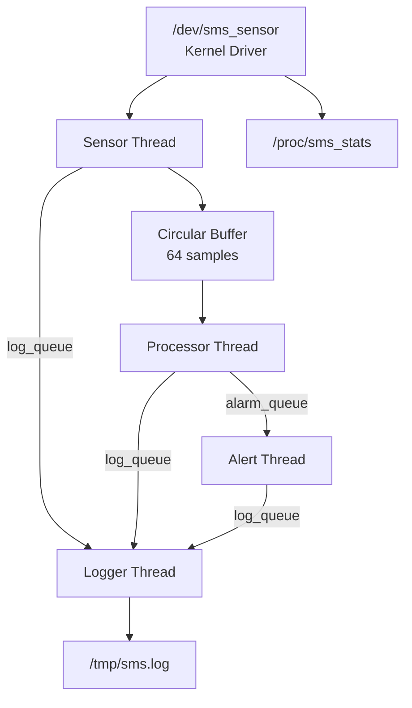
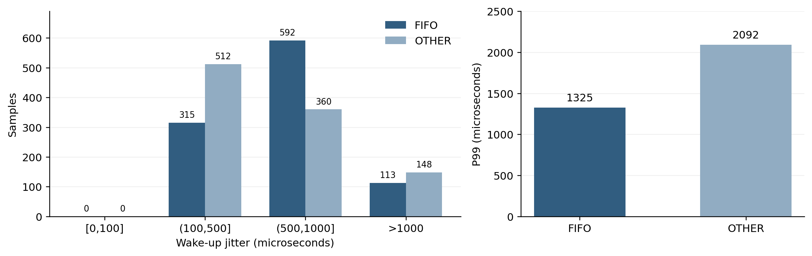

# LOS201 — Sensor Monitoring System / Assignment 02

[Back to Main Page](../README.md) · [Application Source](app/) · [Driver](driver/) · [Logs](logs/) · [PDF Report](bao_cao/SE201095_PhamTranGiaLong_Asgn02_BaoCao.pdf)

Assignment 02 implements a simulated **temperature and humidity monitoring system** on Linux ARMv7 in QEMU.

The project combines:

- Linux kernel driver
- pthreads
- circular buffer
- mutex / condition variable
- POSIX message queues
- logging
- scheduling
- GDB
- Valgrind
- strace
- perf
- jitter measurement

This README is designed as a full implementation and troubleshooting guide.

---

## Table of Contents

- [Architecture](#architecture)
- [Requirements and Data Flow](#requirements)
- [Project Structure](#project-structure)
- [Prerequisites](#prerequisites)
- [Step-by-Step Implementation Guide](#implementation)
- [Building on HOST](#build)
- [Preparing the ARM Root Filesystem](#rootfs)
- [Running on QEMU ARM](#qemu)
- [Functional Testing](#functional-test)
- [Valgrind and Memory Checks](#valgrind)
- [GDB Debugging](#gdb)
- [strace and perf](#profiling)
- [Real-Time Scheduling and Jitter](#jitter)
- [Common Errors and Fixes](#errors)
- [How to Locate the Failure](#debug-flow)
- [Verification Checklist](#checklist)
- [Recorded Results](#results)
- [References](#references)

---

<a id="architecture"></a>
## Architecture




The application has **5 threads total**:

```text
Main
├── Sensor
├── Processor
├── Alert
└── Logger
```

---

<a id="requirements"></a>
## Requirements and Data Flow

### Kernel driver

The driver exposes:

```text
/dev/sms_sensor
/proc/sms_stats
```

Each successful read returns:

```text
<timestamp_ms>,<temperature>,<humidity>\n
```

Expected simulated ranges:

```text
Temperature : 15.0–45.0 °C
Humidity    : 30.0–90.0 %
Resolution  : 0.1
```

The application sets the interval through `SMS_SET_INTERVAL`.

If the device is read too early, the driver may return:

```text
EAGAIN
```

### Application pipeline

```text
Kernel Driver
    ↓
Sensor Thread
    ↓
Circular Buffer
    ↓
Processor Thread
    ↓
Alert Queue
    ↓
Alert Thread

Sensor / Processor / Alert
    ↓
Log Queue
    ↓
Logger Thread
    ↓
sms.log
```

### Default alert conditions

```text
Temperature > 40 °C
Humidity    > 80 %
Temperature change > 5 °C
```

---

<a id="project-structure"></a>
## Project Structure

| Directory | Contents |
|---|---|
| [driver/](driver/) | Sensor kernel module, IOCTL header, Makefile |
| [app/](app/) | Main application, four workers, IPC, buffer, tests |
| [output/](output/) | Kernel, DTB, initramfs |
| [logs/](logs/) | Experimental results |
| [scripts/](scripts/) | GDB automation scripts |
| [docs/images/](docs/images/) | Architecture and result figures |
| [bao_cao/](bao_cao/) | PDF report |

---

<a id="prerequisites"></a>
## Prerequisites

### ARM toolchain

```bash
arm-none-linux-gnueabihf-gcc --version
```

### Kernel source

```bash
ls "$HOME/embedded_lab1/kernel/linux-5.15"
```

### Required kernel feature: POSIX message queues

The application uses POSIX message queues.

If QEMU prints:

```text
mq_open: Function not implemented
```

check the kernel configuration:

```bash
cd "$HOME/embedded_lab1/kernel/linux-5.15"

grep CONFIG_POSIX_MQUEUE .config
```

Expected:

```text
CONFIG_POSIX_MQUEUE=y
CONFIG_POSIX_MQUEUE_SYSCTL=y
```

If missing:

```bash
scripts/config --enable CONFIG_POSIX_MQUEUE
scripts/config --enable CONFIG_POSIX_MQUEUE_SYSCTL

make ARCH=arm \
     CROSS_COMPILE=arm-linux-gnueabihf- \
     olddefconfig

make -j"$(nproc)" \
     ARCH=arm \
     CROSS_COMPILE=arm-linux-gnueabihf- \
     zImage
```

Then replace the QEMU kernel image with the rebuilt `zImage`.

---

<a id="implementation"></a>
## Step-by-Step Implementation Guide

### Step 1 — Implement the kernel sensor driver

The driver should:

1. Register `/dev/sms_sensor`
2. Register `/proc/sms_stats`
3. Generate a simulated sample after the configured interval
4. Return CSV data to userspace
5. Maintain `read_count`
6. Expose latest sample and interval in procfs
7. Support `SMS_SET_INTERVAL`

Useful driver checks:

```bash
grep -n "misc_register" driver/*.c
grep -n "proc_create" driver/*.c
grep -n "SMS_SET_INTERVAL" driver/*
```

### Step 2 — Implement the circular buffer

The circular buffer should include:

```text
capacity = 64
mutex
condition variable
head
tail
size
stop state
```

The Sensor thread pushes samples.  
The Processor thread pops samples.

Important rule:

> Never hold the circular-buffer mutex while waiting for a message queue or writing a file.

### Step 3 — Implement Sensor Thread

Responsibilities:

- Open `/dev/sms_sensor`
- Set interval with ioctl
- Read CSV
- Parse timestamp / temperature / humidity
- Push into circular buffer
- Record jitter
- Use absolute scheduling
- Optionally use `SCHED_FIFO` priority 50

Recommended scheduling API:

```text
CLOCK_MONOTONIC
clock_nanosleep(... TIMER_ABSTIME ...)
```

### Step 4 — Implement Processor Thread

Responsibilities:

- Pop samples
- Maintain rolling window of 10 samples
- Compute average
- Detect:
  - TEMP_HIGH
  - HUMID_HIGH
  - TEMP_SPIKE
- Send alerts through POSIX message queue
- Send log messages to Logger

### Step 5 — Implement Alert Thread

Responsibilities:

- Receive alarm messages
- Print alert
- Count each alert type
- Forward log information to Logger

### Step 6 — Implement Logger Thread

Responsibilities:

- Receive log messages
- Open `/tmp/sms.log`
- Write log entries
- Flush periodically
- Rotate when file exceeds 1 MiB
- Close cleanly during shutdown

### Step 7 — Implement Main

Main should:

1. Parse CLI arguments
2. Initialize IPC and circular buffer
3. Start four worker threads
4. Handle stop request
5. Join workers in dependency order
6. Print final statistics
7. Clean up queues and resources

---

<a id="build"></a>
## Building on HOST

From `Asgn2/`:

```bash
make -C app host debug test
make -C app arm
make -C driver arm \
    KERNEL_DIR="$HOME/embedded_lab1/kernel/linux-5.15"
```

Check binaries:

```bash
file app/sms_app_host
file app/sms_app
file driver/sms_sensor_driver.ko
```

Expected:

```text
sms_app_host        -> x86-64
sms_app             -> ARM
sms_sensor_driver.ko -> ARM relocatable
```

### Common build verification

```bash
ls -lh app/sms_app_host
ls -lh app/sms_app
ls -lh driver/sms_sensor_driver.ko
```

---

<a id="rootfs"></a>
## Preparing the ARM Root Filesystem

Copy the ARM application:

```bash
cp app/sms_app \
   /path/to/rootfs/usr/bin/
```

Copy the driver:

```bash
mkdir -p /path/to/rootfs/lib/modules/5.15.0

cp driver/sms_sensor_driver.ko \
   /path/to/rootfs/lib/modules/5.15.0/
```

Set permissions:

```bash
chmod +x /path/to/rootfs/usr/bin/sms_app
```

Check architecture before repacking:

```bash
file /path/to/rootfs/usr/bin/sms_app
file /path/to/rootfs/lib/modules/5.15.0/sms_sensor_driver.ko
```

Rebuild the initramfs after every replacement.

A very common mistake is:

```text
build new binary
↓
forget to copy into rootfs
↓
QEMU still runs old code
```

---

<a id="qemu"></a>
## Running on QEMU ARM

Example boot command:

```bash
qemu-system-arm \
  -M vexpress-a9 \
  -cpu cortex-a9 \
  -m 512M \
  -smp 2 \
  -nographic \
  -kernel output/zImage \
  -dtb output/vexpress-v2p-ca9.dtb \
  -initrd output/initramfs_asgn2.cpio.gz \
  -append 'console=ttyAMA0,115200 rdinit=/sbin/init mem=512M'
```

Inside QEMU:

```sh
mkdir -p /proc /sys /tmp
mount -t proc proc /proc 2>/dev/null
mount -t sysfs sysfs /sys 2>/dev/null
chmod 1777 /tmp
```

Load the driver:

```sh
insmod /lib/modules/$(uname -r)/sms_sensor_driver.ko
```

Check:

```sh
lsmod
dmesg | tail -n 50
ls -l /dev/sms_sensor
cat /proc/sms_stats
```

---

<a id="functional-test"></a>
## Functional Testing

### Basic driver read

```sh
cat /dev/sms_sensor
```

You may see one valid sample followed by:

```text
Resource temporarily unavailable
```

This can be normal because `cat` immediately performs another read before the configured interval has elapsed.

### Run the full application

```sh
sms_app --fifo -i 500 -d 60 -v --log /tmp/sms.log
```

After completion:

```sh
cat /proc/sms_stats
```

A 60-second run with a 500 ms interval should produce approximately:

```text
120 reads
```

Small differences are expected because of startup/shutdown timing.

### Check log file

```sh
ls -lh /tmp/sms.log
tail -n 30 /tmp/sms.log
```

### Check memory while running

From another shell/process context:

```sh
cat /proc/$(pidof sms_app)/status | \
    grep -E 'VmSize|VmRSS|Threads'
```

---

<a id="valgrind"></a>
## Valgrind and Memory Checks

Valgrind is run on the HOST/MOCK application because it is easier to inspect than the QEMU ARM binary.

Example:

```bash
valgrind \
  --leak-check=full \
  --show-leak-kinds=all \
  ./app/sms_app_host \
  --mock --other \
  -i 500 \
  -d 30 \
  --log /tmp/sms_valgrind.log
```

Expected final condition:

```text
0 bytes in use at exit
0 errors
```

### Error previously encountered: uninitialized bytes

Typical Valgrind symptom:

```text
Syscall param mq_timedsend(msg_ptr) points to uninitialised byte(s)
```

Cause:

```text
struct message contains unused bytes/padding
```

Fix:

```c
LogMessage msg;
memset(&msg, 0, sizeof(msg));
```

Initialize the complete message structure before sending it through the message queue.

---

<a id="gdb"></a>
## GDB Debugging

Build the debug version:

```bash
make -C app debug
```

Run GDB:

```bash
gdb ./app/sms_app_host
```

Useful commands:

```gdb
break buffer_push
break process_data
break create_message
run --mock --other -i 500 -d 10

info threads
thread apply all bt
print variable_name
```

### Conditional breakpoint example

```gdb
break buffer_push if buffer->total_produced >= 5
```

Then inspect:

```gdb
print buffer->head
print buffer->tail
print buffer->size
print buffer->total_produced
```

### If breakpoint never triggers

Check:

```gdb
info breakpoints
info threads
```

Make sure:

- debug symbols are present
- the correct binary is running
- optimization is not hiding variables
- the code path is actually reached

---

<a id="profiling"></a>
## strace and perf

### strace

```bash
strace -f -c \
  -o logs/strace_sms.txt \
  ./app/sms_app_host \
  --mock --other \
  -i 500 \
  -d 30
```

Check:

```bash
cat logs/strace_sms.txt
```

If the file is empty, verify:

```bash
which strace
echo $?
```

### perf

A common error is:

```text
Permission error
perf_event_paranoid
```

Check:

```bash
sysctl kernel.perf_event_paranoid
```

Temporary development setting:

```bash
sudo sysctl kernel.perf_event_paranoid=0
```

Record:

```bash
perf record \
  -e cycles:u \
  -F 999 \
  -g \
  -o logs/perf.data \
  -- ./app/sms_app_host \
  --mock --other \
  -i 10 \
  -d 30
```

Report:

```bash
perf report -i logs/perf.data
```

If no samples are collected, use a shorter interval or more active workload.

---

<a id="jitter"></a>
## Real-Time Scheduling and Jitter

The Sensor scheduling design uses:

```text
SCHED_FIFO
priority = 50
CLOCK_MONOTONIC
TIMER_ABSTIME
```

This avoids accumulating drift from repeated relative sleeps.

### Important scheduling call

Conceptually:

```c
clock_nanosleep(
    CLOCK_MONOTONIC,
    TIMER_ABSTIME,
    &next_deadline,
    NULL
);
```

### Memory locking

The application may call:

```c
mlockall(MCL_CURRENT | MCL_FUTURE);
```

If it fails:

```text
Cannot allocate memory
Operation not permitted
```

check privileges and resource limits.

### SCHED_FIFO failure

Typical message:

```text
Operation not permitted
```

Cause: insufficient scheduling privileges.

Run the target as root or adjust capabilities/resource limits.

### Jitter experiment

Compare:

```text
SCHED_OTHER
vs
SCHED_FIFO priority 50
```

Collect at least 1000 samples.

Useful statistics:

```text
Min
Average
Maximum
P99
0–100 us
100–500 us
500–1000 us
>1000 us
```

Important:

> Jitter is wake-up timing error. It is not the complete sensor-to-alert latency.

---

<a id="errors"></a>
## Common Errors and Fixes

### 1. `mq_open: Function not implemented`

Cause:

```text
CONFIG_POSIX_MQUEUE is missing from the target kernel
```

Check:

```bash
grep CONFIG_POSIX_MQUEUE \
    "$HOME/embedded_lab1/kernel/linux-5.15/.config"
```

Fix: enable POSIX message queues and rebuild `zImage`.

---

### 2. `Exec format error`

Cause: wrong architecture binary.

Check:

```bash
file app/sms_app
```

Target binary must be ARM.

---

### 3. `sms_sensor_driver.ko: invalid module format`

Check:

```sh
uname -r
dmesg | tail -n 40
```

Cause usually:

- wrong kernel version
- wrong kernel config
- wrong architecture

Rebuild module against the exact kernel source used by QEMU.

---

### 4. `/dev/sms_sensor` missing

Check:

```sh
lsmod
dmesg | tail -n 50
```

If the module loaded successfully but no device appears, inspect `misc_register()` and module initialization.

---

### 5. `Resource temporarily unavailable`

Usually:

```text
EAGAIN
```

This can be expected if the application reads sooner than the configured sensor interval.

Check:

```sh
cat /proc/sms_stats
```

Compare the driver interval with application scheduling.

---

### 6. `mlockall` fails

Possible causes:

- insufficient privileges
- low `RLIMIT_MEMLOCK`

Check on HOST:

```bash
ulimit -l
```

For testing, run with appropriate privileges.

---

### 7. `pthread_setschedparam` / SCHED_FIFO fails

Typical error:

```text
Operation not permitted
```

Cause: normal users do not have real-time scheduling permission.

Run as root in the target environment or configure limits/capabilities.

---

### 8. ARM build error: hard-float architecture lacks an FPU

Typical error:

```text
-mfloat-abi=hard selected architecture lacks an FPU
```

Cause: compiler flags specify hard-float without matching FPU settings.

Use a consistent target configuration, for example:

```text
-march=armv7-a
-mfpu=neon-vfpv3
-mfloat-abi=hard
```

or remove unsupported hard-float flags according to your toolchain/rootfs.

---

### 9. `linux/math64.h` or kernel-only headers fail in HOST userspace build

Cause: kernel-only code was accidentally compiled as a normal HOST userspace source.

Fix:

- build kernel modules through Kbuild
- keep kernel and userspace source separated

---

### 10. Valgrind reports uninitialized message bytes

Cause: the full message struct was not initialized.

Fix:

```c
memset(&msg, 0, sizeof(msg));
```

before filling and sending the message.

---

### 11. `perf` permission denied

Check:

```bash
sysctl kernel.perf_event_paranoid
```

Temporary fix for development:

```bash
sudo sysctl kernel.perf_event_paranoid=0
```

---

### 12. perf records almost no samples

Cause: the application spends most time sleeping.

Try:

```bash
-i 10
```

instead of:

```bash
-i 500
```

for profiling-only HOST/MOCK runs.

---

### 13. QEMU still runs the old application

Cause: new binary was built but not copied/repacked into the initramfs.

Check timestamps and hashes:

```bash
ls -lh app/sms_app
ls -lh /path/to/rootfs/usr/bin/sms_app
```

Then copy again and rebuild the initramfs.

---

### 14. Application hangs during shutdown

Check worker dependency order.

Expected shutdown:

```text
Sensor stops
↓
Processor drains buffer
↓
Alert drains alarm queue
↓
Logger drains log queue
↓
Main joins everything
```

Do not send a STOP message to a downstream worker before all of its producers have stopped.

---

<a id="debug-flow"></a>
## How to Locate the Failure

Use this debugging flow:

```text
1. Build fails?
   |
   +-- YES -> compiler / toolchain / Kbuild / header problem
   |
   +-- NO
        |
2. Wrong architecture?
   |
   +-- YES -> rebuild with correct compiler
   |
   +-- NO
        |
3. New files actually copied into rootfs?
   |
   +-- NO -> copy + repack initramfs
   |
   +-- YES
        |
4. QEMU boots expected kernel?
   |
   +-- NO -> zImage/DTB/initramfs mismatch
   |
   +-- YES
        |
5. Driver loads?
   |
   +-- NO -> dmesg + kernel/module mismatch
   |
   +-- YES
        |
6. /dev/sms_sensor appears?
   |
   +-- NO -> driver registration problem
   |
   +-- YES
        |
7. Manual read works?
   |
   +-- NO -> driver read/ioctl logic
   |
   +-- YES
        |
8. Application starts?
   |
   +-- NO -> message queue / CLI / shared library / permissions
   |
   +-- YES
        |
9. Threads run correctly?
   |
   +-- NO -> GDB / thread backtrace / mutex / queue
   |
   +-- YES
        |
10. Memory clean?
    |
    +-- NO -> Valgrind
    |
    +-- YES
         |
11. Performance acceptable?
    |
    +-- NO -> strace / perf / jitter
    |
    +-- YES -> PASS
```

### First commands to run when something is wrong

Inside QEMU:

```sh
uname -r
lsmod
dmesg | tail -n 80
ls -l /dev/sms_sensor
cat /proc/sms_stats
```

On HOST:

```bash
file app/sms_app
file driver/sms_sensor_driver.ko
```

These commands usually identify whether the problem is:

```text
architecture
kernel mismatch
driver registration
rootfs copy
application runtime
```

---

<a id="checklist"></a>
## Verification Checklist

### Driver

- [ ] `sms_sensor_driver.ko` is ARM
- [ ] module loads without error
- [ ] `/dev/sms_sensor` exists
- [ ] `/proc/sms_stats` exists
- [ ] temperature stays in expected range
- [ ] humidity stays in expected range
- [ ] interval ioctl works
- [ ] read_count increments

### Application

- [ ] 4 worker threads start
- [ ] Main + workers = 5 threads
- [ ] Sensor receives samples
- [ ] Processor consumes samples
- [ ] TEMP_HIGH can occur
- [ ] HUMID_HIGH can occur
- [ ] TEMP_SPIKE can occur
- [ ] Logger writes `/tmp/sms.log`
- [ ] graceful shutdown works

### Memory / debugging

- [ ] Valgrind reports 0 bytes at exit
- [ ] Valgrind reports 0 errors
- [ ] GDB can show all 5 threads
- [ ] GDB backtraces are readable
- [ ] `/proc/PID/status` memory is stable

### Profiling

- [ ] strace summary generated
- [ ] perf data generated
- [ ] perf report contains samples
- [ ] jitter has at least 1000 samples
- [ ] FIFO and OTHER can be compared

### Final integration

- [ ] final ARM application is the latest build
- [ ] final kernel module is the latest build
- [ ] initramfs was repacked after copying
- [ ] final logs correspond to final source

---

<a id="results"></a>
## Recorded Results

### ARM integration run

Recorded result:

```text
119 reads
119 processed samples
overflow = 0
fatal = 0
```

### Final Valgrind

```text
20 allocations
20 frees
0 bytes in use at exit
0 errors
```

### Jitter

| Metric | FIFO 50 | OTHER |
|---|---:|---:|
| Samples | 1020 | 1020 |
| Mean | 654.801 µs | 650.691 µs |
| Max | 1597 µs | 2598 µs |
| P99 | 1325 µs | 2092 µs |



The recorded FIFO P99 was lower than OTHER in this measurement pair.

---

<a id="references"></a>
## References

- [POSIX Message Queues](https://man7.org/linux/man-pages/man7/mq_overview.7.html)
- [clock_nanosleep](https://man7.org/linux/man-pages/man2/clock_nanosleep.2.html)
- [Condition Variables](https://man7.org/linux/man-pages/man3/pthread_cond_wait.3.html)
- [Linux Real-Time Documentation](https://docs.kernel.org/core-api/real-time/theory.html)
