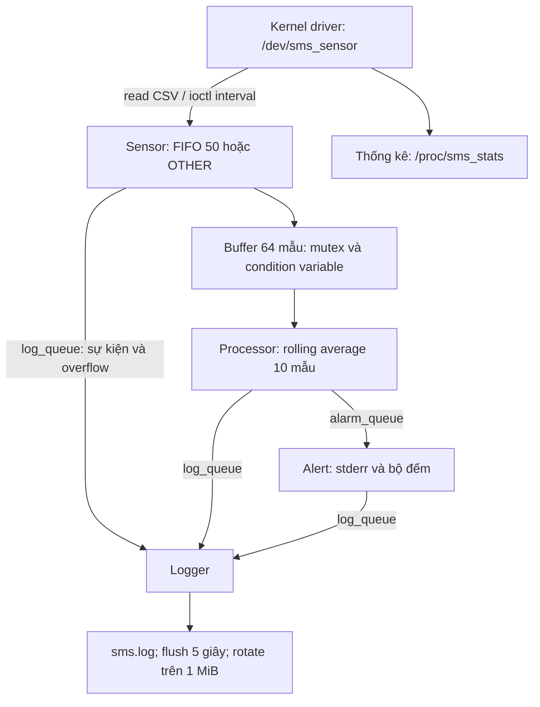

# LOS201 — Sensor Monitoring System / Assignment 02

[Về trang chính](../README.md) · [Source ứng dụng](app/) · [Driver](driver/) · [Log](logs/) · [Báo cáo PDF](bao_cao/SE201095_PhamTranGiaLong_Asgn02_BaoCao.pdf)

Hệ thống giám sát nhiệt độ, độ ẩm mô phỏng trên Linux ARMv7 trong QEMU.
Driver tạo mẫu khi ứng dụng đọc và đã đủ khoảng thời gian tối thiểu;
đây không phải số đo từ cảm biến vật lý. Ứng dụng dùng bốn worker thread
để đọc, xử lý, cảnh báo và ghi log.

## Mục lục

- [Kiến trúc](#kiến-trúc)
- [Driver và dữ liệu mô phỏng](#driver-và-dữ-liệu-mô-phỏng)
- [Cấu trúc](#cấu-trúc)
- [Build trên Ubuntu HOST](#build-trên-ubuntu-host)
- [Chạy chẩn đoán trên HOST](#chạy-chẩn-đoán-trên-host)
- [Chạy trên QEMU ARM](#chạy-trên-qemu-arm)
- [Kết quả thực nghiệm đã lưu](#kết-quả-thực-nghiệm-đã-lưu)
- [Những điểm đã học và sửa](#những-điểm-đã-học-và-sửa)
- [Phiên GDB cuối](#phiên-gdb-cuối)
- [Báo cáo và trạng thái bài nộp](#báo-cáo-và-trạng-thái-bài-nộp)

## Kiến trúc




Main khởi tạo và join worker theo thứ tự phụ thuộc. Khi dừng bình thường:
Sensor đóng buffer; Processor lấy hết mẫu còn lại; Alert nhận hết alarm;
Logger nhận hết log rồi flush và đóng file. `SIGINT`/`SIGTERM` được Main
nhận bằng `sigtimedwait`, không xử lý mutex trong signal handler.

## Driver và dữ liệu mô phỏng

Driver `sms_sensor_driver.ko` đăng ký miscdevice `/dev/sms_sensor` và procfs `/proc/sms_stats`.

| Giao diện | Hành vi |
|---|---|
| `read` | Trả CSV: timestamp millisecond, nhiệt độ và độ ẩm |
| Miền nhiệt độ | 15,0–45,0°C, độ phân giải 0,1°C |
| Miền độ ẩm | 30,0–90,0%, độ phân giải 0,1% |
| `SMS_SET_INTERVAL` | Nhận interval 1–60000 ms qua IOCTL |
| Đọc quá sớm | Trả `EAGAIN`; ứng dụng thử lại trong ngân sách thời gian giới hạn |
| `/proc/sms_stats` | Read count, mẫu gần nhất, interval và uptime |

Driver tạo mẫu khi được đọc và đã đủ interval; không có cảm biến vật lý và cũng không có producer kernel tự đẩy mẫu đều đặn. Sensor thread là phía chủ động đặt lịch đọc.

| Thành phần userspace | Cơ chế |
|---|---|
| Sensor | `CLOCK_MONOTONIC`, absolute deadline; FIFO priority 50 hoặc OTHER |
| Circular buffer | 64 mẫu; mutex và condition variable; khi đầy bỏ mẫu mới |
| Processor | Rolling average 10 mẫu; kiểm tra TEMP_HIGH, HUMID_HIGH và TEMP_SPIKE |
| Ngưỡng mặc định | Nhiệt độ >40°C, độ ẩm >80%, chênh nhiệt độ >5°C |
| Alert | Nhận alarm qua POSIX message queue và đếm theo loại |
| Logger | Một thread sở hữu file; flush 5 giây; rotate trên 1 MiB |


## Cấu trúc

| Thư mục | Nội dung |
|---|---|
| `driver/` | Module, header ioctl, Makefile và công cụ kiểm tra |
| `app/` | Main, bốn worker, buffer, IPC, CLI, xuất jitter và kiểm tra |
| `output/` | Kernel, DTB, cấu hình và initramfs |
| `logs/` | Bản ghi thực nghiệm và dữ liệu gốc |
| `scripts/` | Lệnh ghi phiên GDB |
| `bao_cao/` | Báo cáo PDF |
| `docs/images/` | Sơ đồ, biểu đồ và hình minh chứng dùng trong README |

## Build trên Ubuntu HOST

Toolchain ARM đã sử dụng: `arm-none-linux-gnueabihf-gcc` 13.2.1.
Kernel target: Linux 5.15.0; QEMU `vexpress-a9`, Cortex-A9, 512 MiB, 2 vCPU.
Kernel HOST ghi trong `logs/perf_environment.txt` là 7.0.0-38-generic.

```bash
make -C app host debug test
make -C app arm
make -C driver arm KERNEL_DIR="$HOME/embedded_lab1/kernel/linux-5.15"
```

`make host` tạo `sms_app_host` và tên tương thích yêu cầu nộp `sms_app_x86`.
`make arm` tạo `sms_app`. Không chạy trực tiếp binary ARM trên HOST x86_64.
Biến `CROSS_COMPILE`, `CC_ARM`, `CC_HOST`, `KERNEL_DIR` có thể ghi đè khi build.

## Chạy chẩn đoán trên HOST

```bash
./app/sms_app_host --mock --other -i 500 -d 5 --log /tmp/sms_host.log
```

MOCK tạo dữ liệu xác định trong userspace, bỏ qua driver và khóa bộ nhớ.
Chế độ này phục vụ kiểm tra, GDB, Valgrind, strace/perf; không dùng kết quả
HOST/MOCK để khẳng định độ trễ khi đọc driver ARM.

## Chạy trên QEMU ARM

Từ thư mục project trên HOST, sau khi đã cài ARM app vào rootfs và đóng gói:

```bash
qemu-system-arm -M vexpress-a9 -cpu cortex-a9 -m 512M -smp 2 \
  -nographic -kernel output/zImage -dtb output/vexpress-v2p-ca9.dtb \
  -initrd output/initramfs_asgn2.cpio.gz \
  -append 'console=ttyAMA0,115200 rdinit=/sbin/init mem=512M'
```

Trong QEMU, sau khi nhấn Enter để mở shell:

```sh
insmod /lib/modules/$(uname -r)/sms_sensor_driver.ko
ls -l /dev/sms_sensor
cat /proc/sms_stats
sms_app --fifo -i 500 -d 60 -v --log /tmp/sms.log
cat /proc/sms_stats
```

Các tùy chọn CLI: `-i` (interval), `-t` (ngưỡng nhiệt độ), `-h` (ngưỡng độ ẩm), `-d` (thời lượng), `-v` (verbose); `-d 0` chạy đến khi nhận tín hiệu.
Tùy chọn thêm: `--fifo`, `--other`, `--mock`, `--device`, `--log`, `--help`.
Để demo Ctrl+C, dùng `-d 0`; Main in thống kê sau khi join các worker.
Chỉ thoát QEMU bằng Ctrl+A rồi X sau khi đã xuất dữ liệu cần giữ khỏi `/tmp`.

## Kết quả thực nghiệm đã lưu

Các phiên ARM 60 giây, GDB và Valgrind cuối được lưu tại `logs/final_review/`.
Hai phiên jitter dài và strace/perf được đo trước đợt sửa cuối; giữ nguyên
nguồn để không gán các số đo này cho một binary khác.

| Phép kiểm tra | Kết quả | Nguồn |
|---|---|---|
| QEMU DRIVER/FIFO, 60 giây, 500 ms | 119 đọc, 119 xử lý; overflow 0, fatal 0 | `logs/final_review/qemu/sms_final_output.txt` |
| Thống kê driver sau 60 giây | `read_count=119` | `logs/final_review/qemu/sms_final_stats_after.txt` |
| RAM tại 5/30/55 giây | VmRSS 3480 kB; VmSize 4632 kB; Threads 5 tại cả ba mốc | `logs/final_review/qemu/sms_final_memory_*s.txt` |
| Valgrind HOST/MOCK, dừng SIGINT | 0 byte tại exit; 0 lỗi; 20 alloc / 20 free | `logs/final_review/valgrind_full.txt` |
| strace HOST/MOCK, 30 giây | 1609 syscall; phần lớn là chờ timer, tín hiệu, queue và futex | `logs/strace_summary.txt` |
| perf HOST/MOCK | 59 mẫu cpu-clock; cần thận trọng vì mẫu ít | `logs/perf_report_flat.txt` |


### Jitter: hai phiên QEMU DRIVER, 500 ms, mỗi phiên 510 giây

Jitter là sai số thức dậy trước lần đọc thiết bị, không phải độ trễ đầu-cuối
từ lấy mẫu đến cảnh báo. P99 dùng nearest-rank; đơn vị µs.

| Chỉ số | FIFO 50 | OTHER 0 |
|---|---:|---:|
| Số mẫu jitter | 1020 | 1020 |
| Min | 107 | 147 |
| Mean | 654.801 | 650.691 |
| Max quan sát | 1597 | 2598 |
| P99 | 1325 | 2092 |
| [0,100] µs | 0 | 0 |
| (100,500] µs | 315 | 512 |
| (500,1000] µs | 592 | 360 |
| >1000 µs | 113 | 148 |


P99 của FIFO thấp hơn OTHER 36.66%, trong khi mean hơi cao hơn.
Hai phiên có lần lượt 1018 và 1019 mẫu cảm biến xử lý thành công,
mỗi phiên một lần deferred; mẫu jitter đếm lần thức dậy nên khác số lần đọc.
Nguồn: `logs/jitter/*.csv`, `sms_*_output.txt`, `jitter_summary.txt`.
Đây là một cặp phép đo trong QEMU, chưa có kiểm định qua nhiều lần lặp hoặc
phép đo trên phần cứng ARM thật; max quan sát không phải giới hạn worst-case.

## Những điểm đã học và sửa

- Phân biệt EAGAIN có thể thử lại với lỗi đọc nghiêm trọng; giữ deadline tuyệt đối,
  giới hạn thời gian thử lại và có bộ đếm riêng. Log stage1 và stage2 cho thấy quá trình sửa.
- Bộ đếm mỗi worker có một chủ ghi; Main chỉ đọc sau join. Trạng thái buffer
  và các bộ đếm buffer được bảo vệ bởi cùng mutex; stop/fatal dùng atomic.
- Không giữ mutex buffer trong khi chờ message queue hoặc ghi log; thứ tự
  shutdown giúp tránh gửi STOP trước khi producer kết thúc.
- Rà soát cuối tìm thấy lỗi `20.2f - 15.2f` có thể lớn hơn 5 do sai số float.
  Processor mới so sánh theo đơn vị 0.1°C, phù hợp độ phân giải nguồn dữ liệu.
  `test_processor` kiểm tra biên 5.0°C / 5.1°C và rolling window.
- Sensor mới gửi sự kiện khởi động, dừng, deferred và overflow qua Logger.
- `strace -c` phần trăm thời gian syscall không phải tỉ lệ CPU user/kernel.
  Top syscall theo số lần gọi cũng khác top theo tổng thời gian.

## Phiên GDB cuối

```bash
bash scripts/run_gdb_review.sh
```

Kịch bản B đã được thực hiện: sửa mẫu thành 45°C trong GDB, quan sát kết quả
Processor và điểm nhận `TEMP_HIGH` ở Alert; đồng thời in các thread và backtrace.
Phiên thực chạy được lưu tại `logs/final_review/gdb_session.txt`.
Phiên cuối cho thấy mẫu 45°C tạo TEMP_HIGH, Alert nhận message và bộ đếm
tăng từ 0 lên 1. GDB in đủ 5 thread và backtrace; chương trình thoát bình thường.

## Báo cáo và trạng thái bài nộp

[Báo cáo PDF 21 trang](bao_cao/SE201095_PhamTranGiaLong_Asgn02_BaoCao.pdf)
trình bày thiết kế, đồng bộ, kết quả thực nghiệm và reflection.
Bản repository hiện tại **chưa kèm video demo**, được ghi rõ trong `CHUA_KEM_VIDEO.txt`.

Phiên ARM cuối: `uptime_ms=60030`, 119 đọc/xử lý, TEMP_HIGH=25,
HUMID_HIGH=17, TEMP_SPIKE=77; fatal, overflow, deferred đều 0.
Valgrind cuối chạy HOST/MOCK khoảng 35 giây, nhận SIGINT, 69 mẫu,
20 alloc/20 free, 0 byte tại exit và 0 lỗi. Memcheck không phải công cụ
chứng minh không có data race; phần ownership và khóa được phân tích riêng.

Repository giữ source, Makefile, ARM app, app HOST x86_64, `.ko`, initramfs,
log gốc và báo cáo. Các binary ARM dùng thư viện
động đã được cài trong initramfs; không thay chúng bằng file host hoặc bản rỗng.

## Kiểm tra và xử lý lỗi thường gặp

| Biểu hiện | Kiểm tra |
|---|---|
| `Exec format error` | Dùng `file` để phân biệt binary ARM với x86_64 |
| Không mở được `/dev/sms_sensor` | Xem `lsmod`, `dmesg`, device node và quyền; load đúng module |
| Không tạo được POSIX message queue | Xem cấu hình `CONFIG_POSIX_MQUEUE`, mount mqueue và giới hạn queue |
| `mlockall` hoặc FIFO thất bại | Kiểm tra quyền và giới hạn tài nguyên trong môi trường chạy |
| Có EAGAIN retry | Đối chiếu min-spacing driver và lịch đọc; xem riêng retry, deferred và fatal |
| Có source mới nhưng QEMU vẫn chạy bản cũ | Cài lại app/module vào rootfs và đóng gói lại initramfs |

Các lệnh GDB/Valgrind dưới đây chạy trên HOST với MOCK:

```bash
make -C app host debug test
bash scripts/run_gdb_review.sh
valgrind --leak-check=full --show-leak-kinds=all \
    ./app/sms_app_host --mock --other -i 500 -d 5 \
    --log /tmp/sms_valgrind.log
```

Test buffer và Processor là regression test ở mức ứng dụng. Bài chạy ARM 60 giây kiểm tra tích hợp với kernel driver; hai loại kiểm tra bổ sung cho nhau.

## Tài liệu tham khảo

- [POSIX message queues](https://man7.org/linux/man-pages/man7/mq_overview.7.html)
- [clock_nanosleep](https://man7.org/linux/man-pages/man2/clock_nanosleep.2.html)
- [Condition variables](https://man7.org/linux/man-pages/man3/pthread_cond_wait.3.html)
- [PREEMPT_RT](https://docs.kernel.org/core-api/real-time/theory.html)
