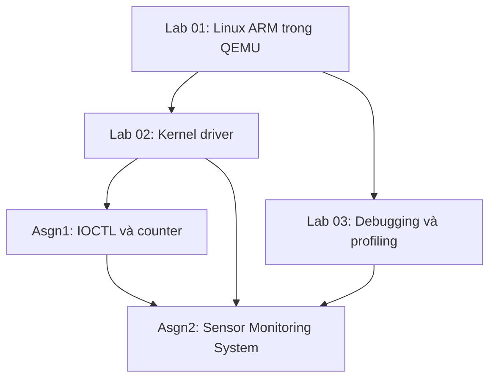

# LOS201 — Embedded Linux Systems

**FPT University · Coursework portfolio · ARMv7 / Linux / QEMU**

[Lab 01](embedded_lab1/README.md) · [Lab 02](embedded_lab2/README.md) · [Lab 03](embedded_lab3/README.md) · [Assignment 01](Asgn1/README.md) · [Assignment 02](Asgn2/README.md)

Repository tổng hợp **3 bài lab và 2 assignment** của môn LOS201. Nội dung đi từ xây dựng môi trường Linux ARM, lập trình kernel driver đến thiết kế một hệ thống giám sát cảm biến đa luồng và phân tích hoạt động của hệ thống bằng công cụ debugging, profiling.

Các thư mục lưu mã nguồn, cấu hình, bản build, báo cáo và log thực nghiệm. README này giới thiệu toàn bộ quá trình; README từng bài trình bày cách chạy và cách đọc kết quả.

## Mục lục

- [Thành viên nhóm](#thành-viên-nhóm)
- [Tổng quan bài thực hành](#tổng-quan-bài-thực-hành)
- [Môi trường kỹ thuật](#môi-trường-kỹ-thuật)
- [Tổ chức repository](#tổ-chức-repository)
- [Bắt đầu sử dụng](#bắt-đầu-sử-dụng)
- [Lab 01 — Xây dựng và khởi động Linux ARM](#lab-01--xây-dựng-và-khởi-động-linux-arm)
- [Lab 02 — Character device driver](#lab-02--character-device-driver)
- [Lab 03 — Debugging và phân tích hiệu năng](#lab-03--debugging-và-phân-tích-hiệu-năng)
- [Assignment 01 — IOCTL và miscellaneous device](#assignment-01--ioctl-và-miscellaneous-device)
- [Assignment 02 — Sensor Monitoring System](#assignment-02--sensor-monitoring-system)
- [Báo cáo và bằng chứng](#báo-cáo-và-bằng-chứng)
- [Kinh nghiệm rút ra](#kinh-nghiệm-rút-ra)
- [Tài liệu tham khảo](#tài-liệu-tham-khảo)

## Thành viên nhóm

| STT | Họ và tên |
|---:|---|
| 1 | Pham Tran Gia Long |
| 2 | Vo Hoang Minh Loc |

Các file nguồn và báo cáo giữ thông tin tác giả được ghi trong từng bài. Phần giới thiệu nhóm không thay thế thông tin tác giả hoặc lịch sử commit.

## Tổng quan bài thực hành

| Bài | Nội dung chính | Kiến thức đạt được | Tài liệu |
|---|---|---|---|
| Lab 01 | Kernel, BusyBox, root filesystem và boot QEMU | Cross-compile, device tree, initramfs, quá trình init | [Hướng dẫn](embedded_lab1/README.md) |
| Lab 02 | Character driver, procfs và sysfs | Giao tiếp userspace–kernel, quản lý buffer và thống kê | [Hướng dẫn](embedded_lab2/README.md) |
| Lab 03 | GDB, Valgrind, strace, perf và cyclictest | Tìm lỗi C, kiểm tra bộ nhớ, quan sát syscall và latency | [Hướng dẫn](embedded_lab3/README.md) |
| Asgn1 | Driver có IOCTL và bộ đếm miscdevice | Thiết kế giao diện điều khiển, kiểm tra đầu vào, đồng bộ | [Hướng dẫn](Asgn1/README.md) |
| Asgn2 | Sensor Monitoring System | pthread, circular buffer, message queue, logging và scheduling | [Hướng dẫn](Asgn2/README.md) |



Lab 01 cung cấp nền tảng để chạy Linux ARM. Lab 02 và Asgn1 phát triển giao tiếp với kernel. Lab 03 cung cấp công cụ kiểm tra. Asgn2 kết hợp những phần này thành ứng dụng có nhiều luồng, đọc dữ liệu từ driver, xử lý, cảnh báo và ghi log.

## Môi trường kỹ thuật

| Thành phần | Môi trường sử dụng |
|---|---|
| Máy phát triển | Ubuntu Linux, x86_64 |
| Kiến trúc target | ARMv7-A, Cortex-A9 |
| Board giả lập | QEMU `vexpress-a9` |
| Linux target | 5.15.0 |
| Userspace nền tảng | BusyBox 1.35.0 |
| Cross compiler của assignment | ARM GNU Toolchain 13.2.1, `arm-none-linux-gnueabihf-` |
| Ngôn ngữ và build | C, shell, Python hỗ trợ, GNU Make |
| Đồng bộ và IPC trong Asgn2 | pthread, mutex, condition variable, atomic, POSIX message queue |
| Debugging / phân tích | GDB, Valgrind, strace, perf, cyclictest |

**HOST** là Ubuntu trên máy phát triển; **TARGET** là Linux ARM chạy trong QEMU. Binary của hai môi trường khác nhau. Module `.ko` phải khớp kiến trúc, kernel và cấu hình của target. Hướng dẫn từng bài chỉ rõ môi trường của lệnh.

Asgn2 dùng 512 MiB RAM và 2 vCPU trong các phiên QEMU được ghi nhận. Kết quả HOST/MOCK phục vụ chẩn đoán ứng dụng; phép đo DRIVER trên QEMU kiểm tra đường đi qua kernel driver.

## Tổ chức repository

| Đường dẫn | Nội dung |
|---|---|
| [embedded_lab1/](embedded_lab1/) | Hướng dẫn build/boot, cấu hình kernel–BusyBox–U-Boot, rootfs, boot images, báo cáo |
| [embedded_lab2/](embedded_lab2/) | Driver, startup files, test script, log, initramfs và báo cáo |
| [embedded_lab3/apps/](embedded_lab3/apps/) | Chương trình có lỗi, chương trình sửa leak và workload profiling |
| [embedded_lab3/logs/](embedded_lab3/logs/) | GDB, Valgrind, strace, perf, cyclictest và histogram |
| [Asgn1/task1_ioctl/](Asgn1/task1_ioctl/) | Driver IOCTL, header dùng chung, ứng dụng điều khiển và test |
| [Asgn1/task2_misc/](Asgn1/task2_misc/) | Counter driver dùng miscdevice và test |
| [Asgn1/logs/](Asgn1/logs/) | Kết quả kiểm thử và kernel log |
| [Asgn2/driver/](Asgn2/driver/) | Driver cảm biến mô phỏng và giao diện IOCTL |
| [Asgn2/app/](Asgn2/app/) | Main, bốn worker, buffer, IPC, CLI, jitter và regression test |
| [Asgn2/output/](Asgn2/output/) | Kernel, device tree và initramfs cho assignment |
| [Asgn2/logs/](Asgn2/logs/) | Kết quả chạy ARM, bộ nhớ, GDB, Valgrind, strace, perf và jitter |

Tên thư mục assignment trong repository là **`Asgn1`** và **`Asgn2`**. Một số lệnh hoặc log gốc vẫn chứa đường dẫn làm việc cũ `~/assignment01` và `~/assignment02` trên máy phát triển.

## Bắt đầu sử dụng

```bash
git clone https://github.com/Longlmao123/LOS201.git
cd LOS201
```

| Mục tiêu | Bắt đầu ở đâu |
|---|---|
| Boot Linux ARM từ các file đã có | [Lab 01: hướng dẫn chạy bản build](embedded_lab1/README.md) |
| Thử đọc/ghi character device | [Lab 02: chạy và kiểm tra driver](embedded_lab2/README.md) |
| Xem quá trình tìm và sửa memory leak | [Lab 03: Valgrind](embedded_lab3/README.md#kiểm-tra-bộ-nhớ-với-valgrind) |
| Kiểm tra IOCTL và counter | [Asgn1: build và kiểm thử](Asgn1/README.md) |
| Chạy nhanh Sensor Monitoring System trên HOST | Lệnh dưới đây |
| Chạy Sensor Monitoring System qua driver ARM | [Asgn2: QEMU](Asgn2/README.md#chạy-trên-qemu-arm) |

```bash
# Chạy từ thư mục LOS201 trên Ubuntu HOST.
make -C Asgn2/app host test
./Asgn2/app/sms_app_host --mock --other -i 500 -d 5 \
    --log /tmp/sms_host.log
```

Chế độ MOCK ở đây tạo dữ liệu trong ứng dụng. Để kiểm tra toàn bộ hệ thống, dùng QEMU và driver theo README Asgn2.

## Lab 01 — Xây dựng và khởi động Linux ARM

Lab 01 tạo môi trường thực thi cho các bài sau: kernel Linux, mô tả phần cứng bằng device tree, userspace BusyBox và initramfs.

| Thành phần | Vai trò |
|---|---|
| `zImage` | Kernel đã cross-compile cho ARM |
| `vexpress-v2p-ca9.dtb` | Mô tả board Cortex-A9 |
| `initramfs.cpio.gz` | Root filesystem ban đầu chứa chương trình và startup files |
| `/sbin/init` | Tiến trình PID 1 khởi tạo userspace |
| `inittab` và `rcS` | Chạy cấu hình khởi động, mount filesystem và mở shell |

Trong đường boot Linux đã kiểm tra, QEMU nhận trực tiếp kernel, DTB và initramfs. Phần build/thử U-Boot được trình bày riêng trong tài liệu Lab 01.

**Tài liệu:** [README chi tiết](embedded_lab1/README.md) · [Cấu hình](embedded_lab1/configs/) · [Boot images](embedded_lab1/output/) · [Báo cáo PDF](embedded_lab1/report/Lab01_Report.pdf)

## Lab 02 — Character device driver

Lab 02 mở rộng hệ thống bằng module `lab2_driver.ko`. Userspace đọc/ghi dữ liệu qua `/dev/lab2`, đồng thời xem trạng thái driver qua procfs và sysfs.


| Giao diện | Chức năng |
|---|---|
| `/dev/lab2` | Gọi các thao tác open, read, write và release |
| `/proc/lab2_info` | Xem thống kê và dữ liệu driver |
| `/sys/class/lab2_class/lab2/` | Đọc các thuộc tính thiết bị |

Driver sử dụng buffer 1024 byte. Bài thực hành giúp phân biệt device node với phần xử lý trong kernel, hiểu cách `file_operations` nối lời gọi userspace tới callback và cách quan sát trạng thái khi test.

**Tài liệu:** [README chi tiết](embedded_lab2/README.md) · [Driver](embedded_lab2/driver/) · [Phiên kiểm thử](embedded_lab2/logs/lab2_full_test.log) · [Báo cáo PDF](embedded_lab2/report/Lab02_Report.pdf)

## Lab 03 — Debugging và phân tích hiệu năng

Lab 03 sử dụng các chương trình C để tìm lỗi, kiểm tra quyền sở hữu bộ nhớ và phân tích hoạt động chương trình.

| Công cụ | Mục tiêu | Bằng chứng |
|---|---|---|
| GDB | Theo dõi luồng chạy, biến và backtrace của chương trình có lỗi | [GDB session](embedded_lab3/logs/gdb_session.txt) |
| Valgrind | So sánh chương trình rò bộ nhớ với bản đã sửa | [Trước](embedded_lab3/logs/valgrind_report.txt) / [Sau](embedded_lab3/logs/valgrind_fixed.txt) |
| strace | Quan sát và tổng hợp system call | [Summary](embedded_lab3/logs/strace_summary.txt) |
| perf | Đo performance counter và xem profile | [Stat](embedded_lab3/logs/perf_stat.txt) / [Report](embedded_lab3/logs/perf_report.txt) |
| cyclictest | Quan sát độ trễ thức dậy theo lịch | [Log](embedded_lab3/logs/cyclictest_standard.txt) |

Valgrind ghi nhận bản ban đầu mất **16.900 byte trong 250 block**. Bản sửa có **352 lần cấp phát, 352 lần giải phóng**, còn **0 byte tại exit** và **0 lỗi Memcheck** trong phiên đã lưu.


**Tài liệu:** [README Lab 03](embedded_lab3/README.md) · [Mã nguồn](embedded_lab3/apps/) · [Log gốc](embedded_lab3/logs/)

## Assignment 01 — IOCTL và miscellaneous device

Asgn1 phát triển hai driver và các chương trình kiểm thử để thực hành thiết kế giao diện userspace–kernel.

| Thành phần | Nội dung |
|---|---|
| Task 1: `/dev/asgn1` | Character driver hỗ trợ read/write và bốn lệnh IOCTL |
| Header IOCTL | Định nghĩa lệnh reset buffer, đọc thống kê, đổi mode và đọc version |
| `asgn1_ctl` | Chương trình userspace gọi IOCTL |
| Task 2: `/dev/counter` | Miscdevice đọc/tăng counter và ghi để đặt lại giá trị |
| `/proc/counter_info` | Thống kê counter, số lần đọc và số lần ghi |

Các test kiểm tra hành vi bình thường, dữ liệu không hợp lệ và cleanup sau unload. Kết quả và kernel log được giữ cùng source để đối chiếu với báo cáo.

**Tài liệu:** [README Asgn1](Asgn1/README.md) · [Task 1](Asgn1/task1_ioctl/) · [Task 2](Asgn1/task2_misc/) · [Log](Asgn1/logs/) · [Báo cáo](Asgn1/bao_cao/SE201095_PhamTranGiaLong_Asgn01_BaoCao.pdf)

## Assignment 02 — Sensor Monitoring System

Asgn2 xây dựng hệ thống giám sát **nhiệt độ và độ ẩm mô phỏng** trên Linux ARM trong QEMU. Module tạo dữ liệu giả khi đọc và đủ khoảng thời gian tối thiểu; các giá trị này không phải số đo từ cảm biến vật lý.


| Worker | Trách nhiệm |
|---|---|
| Sensor | Đọc driver theo lịch, đưa mẫu vào circular buffer và ghi jitter |
| Processor | Lấy mẫu, tính rolling average và phát hiện điều kiện cảnh báo |
| Alert | Nhận alarm qua POSIX message queue, in cảnh báo và cập nhật bộ đếm |
| Logger | Nhận log, ghi file, flush định kỳ và rotate |

Main khởi tạo tài nguyên, nhận yêu cầu dừng và join worker theo thứ tự phụ thuộc. Ứng dụng có **5 thread** tính cả Main. Circular buffer dùng mutex/condition variable; các worker trao đổi alarm và log qua message queue.

### Kết quả thực nghiệm

| Kiểm tra | Kết quả đã ghi nhận | Nguồn |
|---|---|---|
| QEMU DRIVER/FIFO, 500 ms, 60 giây | 119 mẫu đọc / 119 mẫu xử lý; fatal 0; overflow 0 | [ARM output](Asgn2/logs/final_review/qemu/sms_final_output.txt) |
| Bộ nhớ tại 5 / 30 / 55 giây | VmRSS 3480 kB, VmSize 4632 kB, Threads 5 tại cả ba mốc | [RAM 5s](Asgn2/logs/final_review/qemu/sms_final_memory_5s.txt) / [30s](Asgn2/logs/final_review/qemu/sms_final_memory_30s.txt) / [55s](Asgn2/logs/final_review/qemu/sms_final_memory_55s.txt) |
| Valgrind HOST/MOCK, phiên cuối | 20 alloc / 20 free; 0 byte tại exit; 0 lỗi | [Memcheck](Asgn2/logs/final_review/valgrind_full.txt) |
| GDB HOST/MOCK | Sửa mẫu thành 45°C, quan sát TEMP_HIGH và bộ đếm Alert | [GDB session](Asgn2/logs/final_review/gdb_session.txt) |
| Jitter QEMU, 510 giây mỗi policy | P99 FIFO 1325 µs; OTHER 2092 µs | [Dữ liệu jitter](Asgn2/logs/jitter/) |

Hai phiên jitter được thực hiện trước đợt sửa cuối. P99 FIFO thấp hơn OTHER **36,66%** trong cặp phép đo đó; mean FIFO hơi cao hơn. Jitter đo sai số thức dậy trước lần đọc, không đại diện cho độ trễ toàn bộ pipeline hoặc một bảo đảm hard real-time.

**Tài liệu:** [README Asgn2](Asgn2/README.md) · [Ứng dụng](Asgn2/app/) · [Driver](Asgn2/driver/) · [Bằng chứng cuối](Asgn2/logs/final_review/) · [Báo cáo PDF](Asgn2/bao_cao/SE201095_PhamTranGiaLong_Asgn02_BaoCao.pdf)

## Báo cáo và bằng chứng

| Bài | Báo cáo / tài liệu | Dữ liệu thực nghiệm |
|---|---|---|
| Lab 01 | [PDF](embedded_lab1/report/Lab01_Report.pdf), [README](embedded_lab1/README.md) | Các bước xác nhận boot trong README |
| Lab 02 | [PDF](embedded_lab2/report/Lab02_Report.pdf) | [Log kiểm thử](embedded_lab2/logs/lab2_full_test.log) |
| Lab 03 | [README](embedded_lab3/README.md) | [Logs và histogram](embedded_lab3/logs/) |
| Asgn1 | [PDF](Asgn1/bao_cao/SE201095_PhamTranGiaLong_Asgn01_BaoCao.pdf) | [Test và dmesg](Asgn1/logs/) |
| Asgn2 | [PDF](Asgn2/bao_cao/SE201095_PhamTranGiaLong_Asgn02_BaoCao.pdf) | [Log đầy đủ](Asgn2/logs/), [final review](Asgn2/logs/final_review/) |

Bản Asgn2 hiện tại **chưa kèm video demo**. Các file test, báo cáo và log là những loại bằng chứng riêng; đọc đúng phiên chạy và môi trường khi so sánh số liệu.

## Kinh nghiệm rút ra

- **Build thành công chưa đủ để kết luận driver đúng.** Cần boot đúng kernel, load module, kiểm tra giao diện và xem dmesg.
- **Phân biệt HOST và ARM.** Cùng source có thể tạo binary khác kiến trúc; chương trình debug trên HOST không thay thế cho bài test với driver trên target.
- **Định nghĩa rõ quyền sở hữu dữ liệu.** Mỗi worker cập nhật nhóm bộ đếm riêng; Main đọc sau join. Dữ liệu dùng chung cần khóa hoặc atomic phù hợp.
- **Shutdown là một phần thiết kế.** Sensor dừng trước, Processor xử lý hết buffer, Alert xử lý hết alarm rồi Logger mới đóng file.
- **Lỗi biên có thể rất nhỏ.** Trong Asgn2, sai số float ở chênh lệch đúng 5°C được sửa bằng so sánh theo độ phân giải 0,1°C và bổ sung regression test.
- **Số đo cần ngữ cảnh.** FIFO không mặc nhiên tốt hơn ở mọi chỉ số; P99, mean, môi trường chạy và số lần lặp phải được đọc cùng nhau.

## Tài liệu tham khảo

- [Linux kernel documentation](https://docs.kernel.org/)
- [QEMU documentation](https://www.qemu.org/docs/master/)
- [BusyBox](https://busybox.net/)
- [GDB documentation](https://sourceware.org/gdb/documentation/)
- [Valgrind documentation](https://valgrind.org/docs/manual/)
- [POSIX message queue overview](https://man7.org/linux/man-pages/man7/mq_overview.7.html)
- [Repository tham khảo cách tổ chức tài liệu](https://github.com/phuctran2001/LOS201-Embedded-Linux-Group)

README được tổ chức lại theo hướng tổng quan → từng bài → cách chạy → kết quả và bằng chứng. Mã nguồn, tên nhóm và số liệu trình bày ở đây thuộc các file thực tế của repository này.
