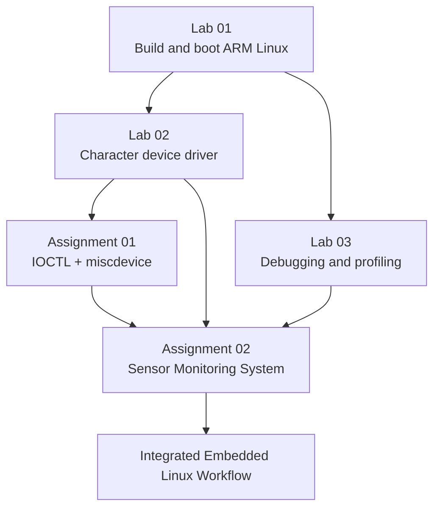

LOS201 — Embedded Linux Systems
FPT University · Coursework Portfolio · ARMv7 / Linux / QEMU

[Lab 01](embedded_lab1/README.md) ·
[Lab 02](embedded_lab2/README.md) ·
[Lab 03](embedded_lab3/README.md) ·
[Assignment 01](Asgn1/README.md) ·
[Assignment 02](Asgn2/README.md)
Table of Contents
- Overview
- Team Members
- Learning Path
- Technical Environment
- Repository Structure
- Quick Start
- Lab 01 — Building and Booting ARM Linux
- Lab 02 — Character Device Driver
- Lab 03 — Debugging and Performance Analysis
- Assignment 01 — IOCTL and Miscellaneous Device Drivers
- Assignment 02 — Sensor Monitoring System
- Reports and Experimental Evidence
- Key Engineering Lessons
- Troubleshooting Guide
- References
- Repository Notes
Overview
This repository documents a complete Embedded Linux Systems learning path across 3 laboratory exercises and 2 assignments.

The work progresses from building and booting an ARM Linux environment, to writing Linux kernel drivers, using debugging and profiling tools, and finally integrating these concepts into a multithreaded sensor monitoring system running on ARMv7 Linux in QEMU.

The repository contains:
- Source code
- Kernel modules
- Build configurations
- QEMU boot images
- Root filesystem artifacts
- Test scripts
- Debugging and profiling logs
- Experimental results
- Reports and supporting evidence
Each lab and assignment has its own README with build instructions, execution steps, and interpretation of the recorded results.
Team Members
No.	Name
1	Pham Tran Gia Long
2	Vo Hoang Minh Loc

Author information stored inside individual source files and reports remains the authoritative record for each work item.
Learning Path
Stage	Main Topic	Key Skills	Documentation
Lab 01	Linux kernel, BusyBox, root filesystem, QEMU boot	Cross-compilation, device tree, initramfs, Linux boot flow	[Open Lab 01](embedded_lab1/README.md)
Lab 02	Character device driver, procfs, sysfs	Userspace–kernel communication, buffers, driver statistics	[Open Lab 02](embedded_lab2/README.md)
Lab 03	Debugging and performance analysis	GDB, Valgrind, strace, perf, cyclictest	[Open Lab 03](embedded_lab3/README.md)
Assignment 01	IOCTL and miscdevice drivers	Control interfaces, input validation, synchronization	[Open Assignment 01](Asgn1/README.md)
Assignment 02	Sensor Monitoring System	pthreads, circular buffer, POSIX MQ, logging, scheduling	[Open Assignment 02](Asgn2/README.md)

How the topics connect
- Lab 01 provides the ARM Linux environment used by later work.
- Lab 02 introduces kernel-space device interfaces and userspace communication.
- Lab 03 adds debugging, memory analysis, syscall tracing, performance profiling, and latency measurement.
- Assignment 01 expands driver design with IOCTL and miscdevice interfaces.
- Assignment 02 integrates kernel-driver access, multithreading, synchronization, IPC, logging, and scheduling into one application.
Technical Environment
Component	Environment
Development machine	Ubuntu Linux, x86_64
Target architecture	ARMv7-A
Target CPU	Cortex-A9
Emulated platform	QEMU vexpress-a9
Target Linux kernel	5.15.0
Base userspace	BusyBox 1.35.0
Assignment cross compiler	ARM GNU Toolchain 13.2.1, arm-none-linux-gnueabihf-
Languages / build tools	C, Shell, supporting Python scripts, GNU Make
Assignment 02 synchronization / IPC	pthread, mutex, condition variable, atomic operations, POSIX message queue
Debugging / analysis tools	GDB, Valgrind, strace, perf, cyclictest

HOST refers to Ubuntu running on the development machine.
TARGET refers to ARM Linux running inside QEMU.

HOST and TARGET binaries are not interchangeable. Kernel modules must match the target architecture, kernel version, and kernel configuration.

Recorded Assignment 02 QEMU runs use:
Machine : vexpress-a9
CPU     : Cortex-A9
RAM     : 512 MiB
vCPU    : 2
Kernel  : Linux 5.15.0
HOST/MOCK measurements are used for application diagnostics. QEMU DRIVER measurements validate the complete path through the ARM kernel driver.
Repository Structure
LOS201/
├── embedded_lab1/
│   ├── configs/
│   ├── output/
│   ├── report/
│   └── README.md
│
├── embedded_lab2/
│   ├── driver/
│   ├── diagrams/
│   ├── logs/
│   ├── report/
│   └── README.md
│
├── embedded_lab3/
│   ├── apps/
│   ├── logs/
│   └── README.md
│
├── Asgn1/
│   ├── task1_ioctl/
│   ├── task2_misc/
│   ├── logs/
│   ├── bao_cao/
│   └── README.md
│
├── Asgn2/
│   ├── app/
│   ├── driver/
│   ├── output/
│   ├── logs/
│   ├── scripts/
│   ├── docs/
│   ├── bao_cao/
│   └── README.md
│
└── README.md
Important directories
Path	Purpose
	Kernel/BusyBox/U-Boot build documentation, rootfs, boot images, and report
	Character driver, startup files, tests, logs, initramfs, and report
	Debugging, memory-leak, and profiling workloads
	GDB, Valgrind, strace, perf, cyclictest, and latency evidence
	IOCTL driver, shared header, control application, and tests
	Counter miscdevice driver and tests
	Assignment 01 test outputs and kernel logs
	Simulated sensor driver and IOCTL interface
	Main application, four workers, buffer, IPC, CLI, jitter, and regression tests
	Kernel, device tree, and assignment initramfs
	ARM runs, memory snapshots, GDB, Valgrind, strace, perf, and jitter

The assignment directories are named Asgn1 and Asgn2 in this repository.

Some original logs and commands may still contain the development-machine paths:
~/assignment01
~/assignment02
Quick Start
Clone the repository
git clone https://github.com/Longlmao123/LOS201.git
cd LOS201
Choose what you want to run
Goal	Start Here
Boot the existing ARM Linux system	[Lab 01 README](embedded_lab1/README.md)
Test a character device driver	[Lab 02 README](embedded_lab2/README.md)
Review GDB / Valgrind / perf / strace experiments	[Lab 03 README](embedded_lab3/README.md)
Test IOCTL and miscdevice drivers	[Assignment 01 README](Asgn1/README.md)
Run the Sensor Monitoring System on HOST	Commands below
Run the Sensor Monitoring System through the ARM driver	[Assignment 02 QEMU Guide](Asgn2/README.md#running-on-qemu-arm)

Quick HOST test for Assignment 02
Run from the repository root on Ubuntu HOST:
make -C Asgn2/app host test

./Asgn2/app/sms_app_host \
    --mock \
    --other \
    -i 500 \
    -d 5 \
    --log /tmp/sms_host.log
MOCK mode generates the sensor data inside userspace.

For full system validation, use QEMU and the ARM driver according to the Assignment 02 README.
Lab 01 — Building and Booting ARM Linux
Lab 01 establishes the execution environment used by the later exercises.

The work includes:
- Linux kernel
- Device tree
- BusyBox userspace
- Initial root filesystem
- initramfs
- startup configuration
- QEMU ARM boot
Main Artifacts
Component	Purpose
zImage	Linux kernel cross-compiled for ARM
vexpress-v2p-ca9.dtb	Hardware description for the Cortex-A9 QEMU board
initramfs.cpio.gz	Initial root filesystem containing userspace programs and startup files
/sbin/init	PID 1 process responsible for starting userspace
inittab and rcS	Startup configuration, filesystem mounting, and shell initialization

In the verified Linux boot path, QEMU receives the kernel, DTB, and initramfs directly.

U-Boot build and testing are documented separately in the Lab 01 materials.
Lab 01 Resources
[Detailed README](embedded_lab1/README.md) ·
[Configurations](embedded_lab1/configs/) ·
[Boot Images](embedded_lab1/output/) ·
[PDF Report](embedded_lab1/report/Lab01_Report.pdf)
Lab 02 — Character Device Driver
Lab 02 extends the system with the kernel module:
lab2_driver.ko
Userspace communicates with the driver through /dev/lab2, while procfs and sysfs expose driver state.

Driver Interfaces
Interface	Function
/dev/lab2	Supports open, read, write, and release operations
/proc/lab2_info	Displays driver data and statistics
/sys/class/lab2_class/lab2/	Exposes device attributes through sysfs

The driver uses a 1024-byte buffer.

The lab demonstrates:
- The difference between a device node and kernel-side driver logic
- How file_operations connects userspace system calls to kernel callbacks
- Buffer management
- Runtime driver inspection
- procfs and sysfs integration
Lab 02 Resources
[Detailed README](embedded_lab2/README.md) ·
[Driver](embedded_lab2/driver/) ·
[Test Session](embedded_lab2/logs/lab2_full_test.log) ·
[PDF Report](embedded_lab2/report/Lab02_Report.pdf)
Lab 03 — Debugging and Performance Analysis
Lab 03 focuses on diagnosing C programs and measuring their behavior.
Tools Used
Tool	Purpose	Evidence
GDB	Inspect execution flow, variables, threads, and backtraces	[GDB Session](embedded_lab3/logs/gdb_session.txt)
Valgrind	Detect memory leaks and verify the corrected program	[Before](embedded_lab3/logs/valgrind_report.txt) / [After](embedded_lab3/logs/valgrind_fixed.txt)
strace	Observe and summarize system calls	[Summary](embedded_lab3/logs/strace_summary.txt)
perf	Collect performance counters and execution profiles	[Stat](embedded_lab3/logs/perf_stat.txt) / [Report](embedded_lab3/logs/perf_report.txt)
cyclictest	Measure scheduled wake-up latency	[Log](embedded_lab3/logs/cyclictest_standard.txt)

Recorded Valgrind Result
The original program recorded:
16,900 bytes lost in 250 blocks
After the correction:
352 allocations
352 frees
0 bytes in use at exit
0 Memcheck errors

Lab 03 Resources
[README](embedded_lab3/README.md) ·
[Applications](embedded_lab3/apps/) ·
[Raw Logs](embedded_lab3/logs/)
Assignment 01 — IOCTL and Miscellaneous Device Drivers
Assignment 01 develops two kernel drivers and corresponding userspace tests.
Task Summary
Component	Description
Task 1: /dev/asgn1	Character driver supporting read/write and four IOCTL commands
Shared IOCTL header	Defines buffer reset, statistics retrieval, mode switching, and version query
asgn1_ctl	Userspace application used to invoke IOCTL operations
Task 2: /dev/counter	Miscdevice used to read/increment and write/reset a counter
/proc/counter_info	Exposes counter value, total reads, and total writes

The tests cover:
- Normal driver operation
- Invalid user input
- Driver statistics
- Cleanup after module unload
Results and kernel logs are stored together with the source so that they can be compared with the report.
Assignment 01 Resources
[README](Asgn1/README.md) ·
[Task 1](Asgn1/task1_ioctl/) ·
[Task 2](Asgn1/task2_misc/) ·
[Logs](Asgn1/logs/) ·
[PDF Report](Asgn1/bao_cao/SE201095_PhamTranGiaLong_Asgn01_BaoCao.pdf)
Assignment 02 — Sensor Monitoring System
Assignment 02 integrates the previous topics into a simulated temperature and humidity monitoring system on ARM Linux in QEMU.

The driver generates simulated data when:
1. The application performs a read.
2. The configured minimum interval has elapsed.
The values are simulated and are not measurements from a physical sensor.

Application Architecture
Worker	Responsibility
Sensor	Reads the driver according to the configured schedule, pushes samples into the circular buffer, and records jitter
Processor	Removes samples, computes a rolling average, and detects alert conditions
Alert	Receives alarms through a POSIX message queue, prints alerts, and updates counters
Logger	Receives log messages, writes the log file, flushes periodically, and performs log rotation

The application contains 5 threads including Main.

Synchronization and communication include:
- pthreads
- mutexes
- condition variables
- atomic state
- circular buffer
- POSIX message queues
Main initializes resources, handles shutdown requests, and joins the workers in dependency order.
Recorded Experimental Results
Test	Recorded Result	Evidence
QEMU DRIVER/FIFO, 500 ms, 60 s	119 reads / 119 processed samples; fatal 0; overflow 0	[ARM Output](Asgn2/logs/final_review/qemu/sms_final_output.txt)
Memory at 5 / 30 / 55 s	VmRSS 3480 kB, VmSize 4632 kB, Threads 5 at all checkpoints	[5 s](Asgn2/logs/final_review/qemu/sms_final_memory_5s.txt) / [30 s](Asgn2/logs/final_review/qemu/sms_final_memory_30s.txt) / [55 s](Asgn2/logs/final_review/qemu/sms_final_memory_55s.txt)
Final HOST/MOCK Valgrind	20 alloc / 20 free; 0 bytes at exit; 0 errors	[Memcheck](Asgn2/logs/final_review/valgrind_full.txt)
HOST/MOCK GDB	Sample changed to 45°C; TEMP_HIGH and Alert counter observed	[GDB Session](Asgn2/logs/final_review/gdb_session.txt)
QEMU jitter, 510 s per policy	FIFO P99 1325 µs; OTHER P99 2092 µs	[Jitter Data](Asgn2/logs/jitter/)

Jitter Result
For the recorded pair of QEMU jitter experiments:
FIFO P99  = 1325 µs
OTHER P99 = 2092 µs
FIFO P99 was 36.66% lower than OTHER for this measurement pair.

However:
- FIFO mean was slightly higher.
- The experiment represents one pair of QEMU measurements.
- The results do not establish a hard real-time guarantee.
- The jitter value represents wake-up timing error before the device read, not total end-to-end pipeline latency.
- These jitter measurements were recorded before the final correction stage.
Assignment 02 Resources
[README](Asgn2/README.md) ·
[Application](Asgn2/app/) ·
[Driver](Asgn2/driver/) ·
[Final Evidence](Asgn2/logs/final_review/) ·
[PDF Report](Asgn2/bao_cao/SE201095_PhamTranGiaLong_Asgn02_BaoCao.pdf)
Reports and Experimental Evidence
Work Item	Report / Documentation	Experimental Evidence
Lab 01	[PDF](embedded_lab1/report/Lab01_Report.pdf), [README](embedded_lab1/README.md)	Boot verification steps documented in the README
Lab 02	[PDF](embedded_lab2/report/Lab02_Report.pdf)	[Test Log](embedded_lab2/logs/lab2_full_test.log)
Lab 03	[README](embedded_lab3/README.md)	[Logs and Histogram](embedded_lab3/logs/)
Assignment 01	[PDF](Asgn1/bao_cao/SE201095_PhamTranGiaLong_Asgn01_BaoCao.pdf)	[Tests and dmesg](Asgn1/logs/)
Assignment 02	[PDF](Asgn2/bao_cao/SE201095_PhamTranGiaLong_Asgn02_BaoCao.pdf)	[Full Logs](Asgn2/logs/), [Final Review](Asgn2/logs/final_review/)

The current Assignment 02 repository does not include the demo video.

Test scripts, reports, logs, and performance measurements are different forms of evidence. Results should always be interpreted together with the environment and execution session in which they were produced.
Key Engineering Lessons
1. A successful build does not prove that a driver works
A kernel module still needs to be tested against the correct kernel and target environment.

A complete validation flow includes:
build
→ boot correct kernel
→ load module
→ verify device interface
→ execute userspace test
→ inspect dmesg / procfs / sysfs
2. HOST and TARGET must be treated as separate environments
The same source code can produce binaries for different architectures.

An x86_64 debugging run is useful, but it does not replace ARM integration testing through the actual kernel driver.
3. Shared data needs explicit ownership
Multithreaded software becomes easier to reason about when each worker has clearly defined responsibilities.

Assignment 02 uses:
- Per-worker counters
- Main-side statistics collection after join
- Mutex protection for shared buffer state
- Atomic state where appropriate
4. Shutdown behavior is part of the architecture
A correct shutdown sequence prevents data loss and deadlocks.

The application follows the dependency order:
Sensor stops
→ Processor drains the buffer
→ Alert drains pending alarms
→ Logger flushes remaining logs
→ resources are released
5. Small numerical edge cases matter
Assignment 02 identified a floating-point boundary issue around an exact 5°C difference.

The final comparison uses the source resolution of 0.1°C, with regression tests around the 5.0°C / 5.1°C boundary.
6. Performance numbers always need context
A single number is not enough.

When interpreting timing or profiling results, consider:
- Mean
- P99
- Maximum observed value
- Scheduler policy
- HOST vs TARGET
- MOCK vs DRIVER
- Number of repetitions
- Whether the result is end-to-end latency or only one stage of the pipeline
Troubleshooting Guide
Problem	What to Check
Exec format error	Verify whether the executable is ARM or x86_64 using file
Kernel module does not load	Check kernel version, architecture, module build configuration, and dmesg
/dev/... is missing	Verify the module is loaded and the device node was created
procfs/sysfs path is missing	Check driver initialization and cleanup code
QEMU still runs an old binary	Reinstall the new binary/module into the rootfs and rebuild the initramfs
POSIX message queue creation fails	Check CONFIG_POSIX_MQUEUE, mqueue mount, and queue limits
mlockall or FIFO scheduling fails	Check permissions and runtime resource limits
HOST binary works but ARM binary fails	Verify architecture, dynamic libraries, rootfs contents, and target kernel compatibility

References
- Linux Kernel Documentation
- QEMU Documentation
- BusyBox
- GDB Documentation
- Valgrind Documentation
- POSIX Message Queue Overview
- Reference Repository Structure
Repository Notes
This README is organized as:
Overview
→ Learning path
→ Technical environment
→ Repository structure
→ Quick start
→ Individual labs and assignments
→ Experimental evidence
→ Engineering lessons
→ Troubleshooting
All project names, team information, measurements, and file references presented here are based on the actual repository materials.
