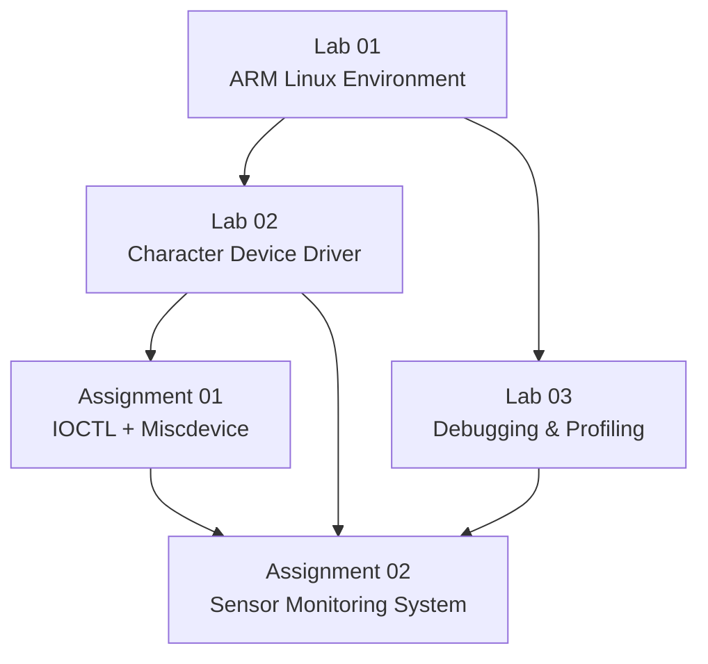
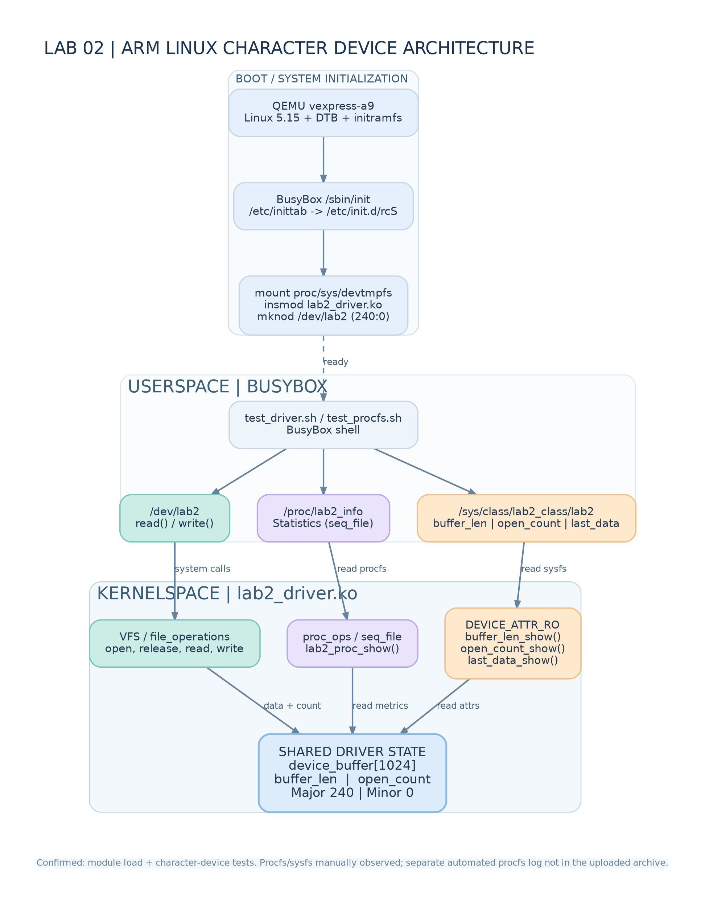

# LOS201 — Embedded Linux Systems

**FPT University · Coursework Portfolio · ARMv7 / Linux / QEMU**

[Lab 01](embedded_lab1/README.md) · [Lab 02](embedded_lab2/README.md) · [Lab 03](embedded_lab3/README.md) · [Assignment 01](Asgn1/README.md) · [Assignment 02](Asgn2/README.md)

This repository documents **3 laboratory exercises and 2 assignments** from LOS201 — Embedded Linux Systems.

The coursework progresses from building an ARM Linux environment, to Linux kernel-driver development, debugging and profiling, and finally to a multithreaded Sensor Monitoring System running on ARMv7 Linux in QEMU.

The repository contains source code, kernel modules, build configurations, boot artifacts, reports, test scripts, and experimental logs. Each lab and assignment has its own detailed README with build instructions, testing steps, troubleshooting guidance, and recorded results.

---

## Table of Contents

- [Team Members](#team-members)
- [Coursework Overview](#coursework-overview)
- [Technical Environment](#technical-environment)
- [Repository Structure](#repository-structure)
- [Getting Started](#getting-started)
- [Lab 01 — Building and Booting ARM Linux](#lab01)
- [Lab 02 — Character Device Driver](#lab02)
- [Lab 03 — Debugging and Performance Analysis](#lab03)
- [Assignment 01 — IOCTL and Miscellaneous Device Drivers](#assignment01)
- [Assignment 02 — Sensor Monitoring System](#assignment02)
- [Reports and Experimental Evidence](#reports)
- [Key Lessons Learned](#lessons)
- [References](#references)

---

<a id="team-members"></a>
## Team Members

| No. | Name |
|---:|---|
| 1 | Pham Tran Gia Long |
| 2 | Vo Hoang Minh Loc |

Author information stored in individual source files and reports remains the authoritative record for each work item.

---

<a id="coursework-overview"></a>
## Coursework Overview

| Work | Main Topic | Skills Developed | Documentation |
|---|---|---|---|
| **Lab 01** | Linux kernel, BusyBox, root filesystem, QEMU boot | Cross-compilation, device tree, initramfs, Linux boot flow | [Guide](embedded_lab1/README.md) |
| **Lab 02** | Character driver, procfs, sysfs | Userspace–kernel communication, buffer management, driver statistics | [Guide](embedded_lab2/README.md) |
| **Lab 03** | GDB, Valgrind, strace, perf, cyclictest | Debugging, memory checking, syscall tracing, profiling, latency analysis | [Guide](embedded_lab3/README.md) |
| **Assignment 01** | IOCTL and miscdevice drivers | IOCTL ABI, validation, userspace/kernel control interface, troubleshooting | [Detailed Guide](Asgn1/README.md) |
| **Assignment 02** | Sensor Monitoring System | pthreads, circular buffer, POSIX MQ, logging, scheduling, profiling, jitter | [Detailed Guide](Asgn2/README.md) |



### Learning Progression

```text
Build ARM Linux
    ↓
Understand kernel/userspace interfaces
    ↓
Develop character and miscdevice drivers
    ↓
Debug memory, syscalls, CPU behavior and latency
    ↓
Integrate driver + multithreaded userspace application
    ↓
Measure correctness, memory usage, performance and jitter
```

---

<a id="technical-environment"></a>
## Technical Environment

| Component | Environment |
|---|---|
| Development HOST | Ubuntu Linux, x86_64 |
| Target architecture | ARMv7-A |
| Target CPU | Cortex-A9 |
| Emulated platform | QEMU `vexpress-a9` |
| Target Linux kernel | 5.15.0 |
| Base userspace | BusyBox 1.35.0 |
| Assignment cross compiler | ARM GNU Toolchain 13.2.1, `arm-none-linux-gnueabihf-` |
| Languages / build tools | C, Shell, supporting Python scripts, GNU Make |
| Assignment 02 IPC / synchronization | pthread, mutex, condition variable, atomic state, POSIX message queues |
| Debugging / analysis tools | GDB, Valgrind, strace, perf, cyclictest |

> **HOST** = Ubuntu running on the development machine.  
> **TARGET** = ARM Linux running inside QEMU.

HOST and TARGET binaries are not interchangeable. Kernel modules must match the target architecture, kernel version, and kernel configuration.

Recorded Assignment 02 QEMU sessions use:

```text
Machine : vexpress-a9
CPU     : Cortex-A9
RAM     : 512 MiB
vCPU    : 2
Kernel  : Linux 5.15.0
```

---

<a id="repository-structure"></a>
## Repository Structure

```text
LOS201/
├── embedded_lab1/
├── embedded_lab2/
├── embedded_lab3/
├── Asgn1/
│   ├── task1_ioctl/
│   ├── task2_misc/
│   ├── logs/
│   ├── report/
│   └── README.md
├── Asgn2/
│   ├── app/
│   ├── driver/
│   ├── output/
│   ├── logs/
│   ├── scripts/
│   ├── docs/
│   ├── report/
│   └── README.md
└── README.md
```

| Path | Contents |
|---|---|
| [embedded_lab1/](embedded_lab1/) | Kernel/BusyBox/U-Boot build guide, rootfs, boot images, configuration, report |
| [embedded_lab2/](embedded_lab2/) | Character driver, startup files, tests, logs, initramfs, report |
| [embedded_lab3/apps/](embedded_lab3/apps/) | Debugging, memory-leak, and profiling programs |
| [embedded_lab3/logs/](embedded_lab3/logs/) | GDB, Valgrind, strace, perf, cyclictest, latency histogram |
| [Asgn1/task1_ioctl/](Asgn1/task1_ioctl/) | IOCTL driver, shared header, userspace controller, test script |
| [Asgn1/task2_misc/](Asgn1/task2_misc/) | Counter miscdevice driver and test script |
| [Asgn1/logs/](Asgn1/logs/) | Assignment 01 test outputs and kernel logs |
| [Asgn2/driver/](Asgn2/driver/) | Simulated sensor driver and IOCTL interface |
| [Asgn2/app/](Asgn2/app/) | Main application, four workers, buffer, IPC, CLI, jitter, regression tests |
| [Asgn2/output/](Asgn2/output/) | Kernel, DTB, assignment initramfs |
| [Asgn2/logs/](Asgn2/logs/) | ARM runs, memory snapshots, GDB, Valgrind, strace, perf, jitter |

---

<a id="getting-started"></a>
## Getting Started

### Clone the Repository

```bash
git clone https://github.com/Longlmao123/LOS201.git
cd LOS201
```

### Choose a Starting Point

| Goal | Start Here |
|---|---|
| Boot ARM Linux | [Lab 01 README](embedded_lab1/README.md) |
| Test a character device driver | [Lab 02 README](embedded_lab2/README.md) |
| Learn GDB / Valgrind / strace / perf | [Lab 03 README](embedded_lab3/README.md) |
| Build and debug IOCTL + miscdevice drivers | [Assignment 01 Detailed Guide](Asgn1/README.md) |
| Build the Sensor Monitoring System | [Assignment 02 Detailed Guide](Asgn2/README.md) |

### Quick HOST Test for Assignment 02

```bash
make -C Asgn2/app host test

./Asgn2/app/sms_app_host \
    --mock \
    --other \
    -i 500 \
    -d 5 \
    --log /tmp/sms_host.log
```

MOCK mode generates data inside userspace and is useful for application-level diagnostics.

For full ARM integration testing, follow the [Assignment 02 QEMU guide](Asgn2/README.md#qemu).

---

<a id="lab01"></a>
## Lab 01 — Building and Booting ARM Linux

Lab 01 creates the ARM Linux environment used by later exercises.

Main components:

| Component | Role |
|---|---|
| `zImage` | Linux kernel cross-compiled for ARM |
| `vexpress-v2p-ca9.dtb` | Hardware description for the Cortex-A9 QEMU platform |
| `initramfs.cpio.gz` | Initial root filesystem |
| `/sbin/init` | PID 1 userspace process |
| `inittab`, `rcS` | Startup configuration |

The verified boot path uses QEMU with the ARM kernel, DTB, and initramfs.

**Resources:** [README](embedded_lab1/README.md) · [Configurations](embedded_lab1/configs/) · [Boot Images](embedded_lab1/output/) · [PDF Report](embedded_lab1/report/Lab01_Report.pdf)

---

<a id="lab02"></a>
## Lab 02 — Character Device Driver

Lab 02 introduces a Linux character device driver and runtime interfaces through `/dev`, procfs, and sysfs.



| Interface | Function |
|---|---|
| `/dev/lab2` | open, read, write, release |
| `/proc/lab2_info` | Driver statistics and current data |
| `/sys/class/lab2_class/lab2/` | Device attributes |

The driver uses a **1024-byte buffer** and demonstrates how userspace system calls are connected to kernel callbacks through `file_operations`.

**Resources:** [README](embedded_lab2/README.md) · [Driver](embedded_lab2/driver/) · [Test Log](embedded_lab2/logs/lab2_full_test.log) · [PDF Report](embedded_lab2/report/Lab02_Report.pdf)

---

<a id="lab03"></a>
## Lab 03 — Debugging and Performance Analysis

Lab 03 focuses on finding software bugs and understanding runtime behavior.

| Tool | Purpose | Evidence |
|---|---|---|
| GDB | Execution flow, variables, threads, backtraces | [GDB Session](embedded_lab3/logs/gdb_session.txt) |
| Valgrind | Memory leak detection and verification | [Before](embedded_lab3/logs/valgrind_report.txt) / [After](embedded_lab3/logs/valgrind_fixed.txt) |
| strace | System-call observation and summary | [Summary](embedded_lab3/logs/strace_summary.txt) |
| perf | Performance counters and profiling | [Stat](embedded_lab3/logs/perf_stat.txt) / [Report](embedded_lab3/logs/perf_report.txt) |
| cyclictest | Scheduled wake-up latency | [Log](embedded_lab3/logs/cyclictest_standard.txt) |

Recorded Valgrind comparison:

```text
Before:
16,900 bytes lost in 250 blocks

After:
352 allocations
352 frees
0 bytes in use at exit
0 Memcheck errors
```


**Resources:** [README](embedded_lab3/README.md) · [Applications](embedded_lab3/apps/) · [Logs](embedded_lab3/logs/)

---

<a id="assignment01"></a>
## Assignment 01 — IOCTL and Miscellaneous Device Drivers

Assignment 01 develops two kernel drivers and their userspace control/test programs.

| Component | Description |
|---|---|
| `/dev/asgn1` | Character driver with read/write and four IOCTL commands |
| `asgn1_ioctl.h` | Shared kernel/userspace IOCTL ABI |
| `asgn1_ctl` | Userspace IOCTL control program |
| `/dev/counter` | Miscdevice counter driver |
| `/proc/counter_info` | Counter and read/write statistics |

The detailed Assignment 01 README includes:

- prerequisites;
- step-by-step module build;
- ARM userspace build;
- rootfs installation;
- QEMU testing;
- manual and automated tests;
- common errors and fixes;
- debugging flow;
- final verification checklist.

**Detailed Guide:** [Asgn1/README.md](Asgn1/README.md)

**Resources:** [Task 1](Asgn1/task1_ioctl/) · [Task 2](Asgn1/task2_misc/) · [Logs](Asgn1/logs/) · [PDF Report](Asgn1/report/SE201095_PhamTranGiaLong_Asgn01_BaoCao.pdf)

---

<a id="assignment02"></a>
## Assignment 02 — Sensor Monitoring System

Assignment 02 integrates the earlier Linux, driver, debugging, IPC, and scheduling topics into a simulated **temperature and humidity monitoring system**.


### Application Threads

| Worker | Responsibility |
|---|---|
| Sensor | Reads `/dev/sms_sensor`, schedules sampling, records jitter |
| Processor | Consumes samples, computes rolling average, detects alerts |
| Alert | Receives POSIX MQ alarm messages and updates alert counters |
| Logger | Writes logs, flushes periodically, performs rotation |
| Main | Initializes resources, handles shutdown, joins workers |

The application contains **5 threads total including Main**.

### Recorded Integration Results

| Test | Result | Evidence |
|---|---|---|
| QEMU DRIVER/FIFO, 500 ms, 60 s | 119 reads / 119 processed samples; fatal 0; overflow 0 | [ARM Output](Asgn2/logs/final_review/qemu/sms_final_output.txt) |
| Memory at 5 / 30 / 55 s | VmRSS 3480 kB, VmSize 4632 kB, Threads 5 | [Final QEMU Logs](Asgn2/logs/final_review/qemu/) |
| Final HOST/MOCK Valgrind | 20 alloc / 20 free; 0 bytes at exit; 0 errors | [Memcheck](Asgn2/logs/final_review/valgrind_full.txt) |
| HOST/MOCK GDB | 45°C sample triggers TEMP_HIGH path | [GDB Session](Asgn2/logs/final_review/gdb_session.txt) |
| QEMU jitter | FIFO P99 1325 µs; OTHER P99 2092 µs | [Jitter Data](Asgn2/logs/jitter/) |

### Jitter Summary

```text
FIFO P99  = 1325 µs
OTHER P99 = 2092 µs
```

For the recorded pair, FIFO P99 was **36.66% lower** than OTHER.

These measurements represent wake-up timing error before the device read, not end-to-end sensor-to-alert latency.

The detailed Assignment 02 README includes:

- kernel prerequisites;
- POSIX MQ kernel configuration;
- implementation steps for each worker;
- ARM rootfs integration;
- QEMU execution;
- Valgrind;
- GDB;
- strace;
- perf;
- real-time scheduling and jitter;
- common errors and fixes;
- debugging flow;
- final verification checklist.

**Detailed Guide:** [Asgn2/README.md](Asgn2/README.md)

**Resources:** [Application](Asgn2/app/) · [Driver](Asgn2/driver/) · [Logs](Asgn2/logs/) · [Final Review](Asgn2/logs/final_review/) · [PDF Report](Asgn2/report/SE201095_PhamTranGiaLong_Asgn02_BaoCao.pdf)

---

<a id="reports"></a>
## Reports and Experimental Evidence

| Work Item | Documentation | Experimental Evidence |
|---|---|---|
| Lab 01 | [README](embedded_lab1/README.md), [PDF](embedded_lab1/report/Lab01_Report.pdf) | Boot verification documented in the Lab 01 guide |
| Lab 02 | [README](embedded_lab2/README.md), [PDF](embedded_lab2/report/Lab02_Report.pdf) | [Test Log](embedded_lab2/logs/lab2_full_test.log) |
| Lab 03 | [README](embedded_lab3/README.md) | [Debugging and profiling logs](embedded_lab3/logs/) |
| Assignment 01 | [Detailed README](Asgn1/README.md), [PDF](Asgn1/report/SE201095_PhamTranGiaLong_Asgn01_BaoCao.pdf) | [Tests and kernel logs](Asgn1/logs/) |
| Assignment 02 | [Detailed README](Asgn2/README.md), [PDF](Asgn2/report/SE201095_PhamTranGiaLong_Asgn02_BaoCao.pdf) | [Full Logs](Asgn2/logs/), [Final Review](Asgn2/logs/final_review/) |

> Assignment 02 currently does **not include the demo video**.

---

<a id="lessons"></a>
## Key Lessons Learned

- **A successful build does not prove a driver is correct.** Runtime verification is still required.
- **HOST and TARGET are separate environments.** Always verify binary architecture using `file`.
- **Kernel module compatibility matters.** `.ko` files must match the target kernel and configuration.
- **Userspace/kernel interfaces require stable ABIs.** Shared IOCTL definitions must remain consistent.
- **Multithreaded ownership must be explicit.** Buffers, counters, queues, and stop states need clear synchronization.
- **Shutdown order is part of system design.** Producers must stop before downstream consumers terminate.
- **Debugging should proceed layer by layer.** Build → architecture → rootfs → kernel → driver → interface → application → memory → performance.
- **Performance numbers require context.** Mean, P99, maximum observed, scheduler, environment, and measurement scope must be interpreted together.

---

<a id="references"></a>
## References

- [Linux Kernel Documentation](https://docs.kernel.org/)
- [QEMU Documentation](https://www.qemu.org/docs/master/)
- [BusyBox](https://busybox.net/)
- [GDB Documentation](https://sourceware.org/gdb/documentation/)
- [Valgrind Documentation](https://valgrind.org/docs/manual/)
- [POSIX Message Queue Overview](https://man7.org/linux/man-pages/man7/mq_overview.7.html)
- [Reference Repository Structure](https://github.com/phuctran2001/LOS201-Embedded-Linux-Group)
