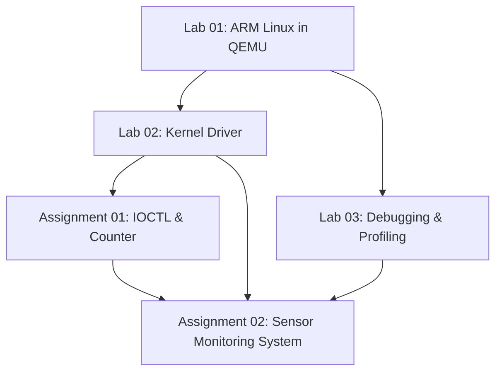

LOS201 — Embedded Linux Systems
FPT University · Coursework Portfolio · ARMv7 / Linux / QEMU

[Lab 01](embedded_lab1/README.md) · [Lab 02](embedded_lab2/README.md) · [Lab 03](embedded_lab3/README.md) · [Assignment 01](Asgn1/README.md) · [Assignment 02](Asgn2/README.md)

This repository brings together 3 labs and 2 assignments from LOS201 — Embedded Linux Systems. The work progresses from building an ARM Linux environment, to kernel-driver development, debugging and profiling, and finally to a multithreaded Sensor Monitoring System running on ARMv7 Linux in QEMU.

The folders contain source code, configurations, build artifacts, reports, and experimental logs. This README provides the overall project map, while each lab and assignment contains its own detailed build, execution, and result-analysis guide.
Table of Contents
- Team Members
- Coursework Overview
- Technical Environment
- Repository Structure
- Getting Started
- Lab 01 — Building and Booting ARM Linux
- Lab 02 — Character Device Driver
- Lab 03 — Debugging and Performance Analysis
- Assignment 01 — IOCTL and Miscellaneous Device
- Assignment 02 — Sensor Monitoring System
- Reports and Experimental Evidence
- Key Lessons Learned
- References

Team Members
No.	Name
1	Pham Tran Gia Long
2	Vo Hoang Minh Loc

Author information stored in individual source files and reports remains the authoritative record for each work item. This team overview does not replace source-level authorship or commit history.

Coursework Overview
Work	Main Topic	Skills Developed	Documentation
Lab 01	Linux kernel, BusyBox, root filesystem, QEMU boot	Cross-compilation, device tree, initramfs, Linux boot flow	[Guide](embedded_lab1/README.md)
Lab 02	Character driver, procfs, sysfs	Userspace–kernel communication, buffer management, driver statistics	[Guide](embedded_lab2/README.md)
Lab 03	GDB, Valgrind, strace, perf, cyclictest	Debugging, memory checking, syscall tracing, profiling, latency analysis	[Guide](embedded_lab3/README.md)
Assignment 01	IOCTL driver and miscdevice counter	Control interfaces, validation, synchronization	[Guide](Asgn1/README.md)
Assignment 02	Sensor Monitoring System	pthreads, circular buffer, POSIX MQ, logging, scheduling	[Guide](Asgn2/README.md)

Lab 01 provides the execution platform for ARM Linux. Lab 02 and Assignment 01 focus on kernel interfaces and userspace communication. Lab 03 introduces the tools needed to debug and measure software behavior. Assignment 02 combines these topics into a multithreaded application that reads simulated sensor data from a kernel driver, processes it, generates alerts, and writes logs.

Technical Environment
Component	Environment
Development HOST	Ubuntu Linux, x86_64
Target architecture	ARMv7-A, Cortex-A9
Emulated board	QEMU vexpress-a9
Target Linux kernel	5.15.0
Base userspace	BusyBox 1.35.0
Assignment cross compiler	ARM GNU Toolchain 13.2.1, arm-none-linux-gnueabihf-
Languages / build tools	C, Shell, supporting Python scripts, GNU Make
Assignment 02 synchronization / IPC	pthread, mutex, condition variable, atomic state, POSIX message queues
Debugging / analysis	GDB, Valgrind, strace, perf, cyclictest

HOST = Ubuntu running on the development machine.
TARGET = ARM Linux running inside QEMU.

HOST and TARGET binaries are different. Kernel modules must match the target architecture, kernel version, and kernel configuration.

Recorded Assignment 02 QEMU runs use 512 MiB RAM and 2 vCPU. HOST/MOCK runs are used for application diagnostics, while QEMU DRIVER runs validate the complete path through the ARM kernel driver.

Repository Structure
Path	Contents
	Kernel/BusyBox/U-Boot build guide, rootfs, boot images, configuration, report
	Character driver, startup files, tests, logs, initramfs, report
	Debugging, memory-leak, and profiling programs
	GDB, Valgrind, strace, perf, cyclictest, latency histogram
	IOCTL driver, shared header, userspace controller, test script
	Counter miscdevice driver and test script
	Assignment 01 test outputs and kernel logs
	Simulated sensor driver and IOCTL interface
	Main app, four workers, buffer, IPC, CLI, jitter and regression tests
	Kernel, device tree and assignment initramfs
	ARM runs, memory snapshots, GDB, Valgrind, strace, perf and jitter

The assignment directories in this repository are named Asgn1 and Asgn2. Some original logs may still contain older development paths such as ~/assignment01 and ~/assignment02.

Getting Started
git clone https://github.com/Longlmao123/LOS201.git
cd LOS201
Goal	Start Here
Boot ARM Linux from the existing build artifacts	[Lab 01 — Boot Guide](embedded_lab1/README.md)
Test a character device driver	[Lab 02 — Driver Guide](embedded_lab2/README.md)
Review debugging and profiling workflows	[Lab 03 — Debugging Guide](embedded_lab3/README.md)
Test IOCTL and miscdevice drivers	[Assignment 01](Asgn1/README.md)
Run Sensor Monitoring System on HOST	Commands below
Run Sensor Monitoring System through ARM driver	[Assignment 02 — QEMU Guide](Asgn2/README.md#running-on-qemu-arm)

Quick HOST test for Assignment 02
make -C Asgn2/app host test

./Asgn2/app/sms_app_host --mock --other -i 500 -d 5 \
    --log /tmp/sms_host.log
MOCK mode generates data inside the userspace application. For full integration testing, use QEMU and the kernel driver according to the Assignment 02 README.

Lab 01 — Building and Booting ARM Linux
Lab 01 establishes the execution environment used by the later coursework: Linux kernel, device tree, BusyBox userspace, initramfs, and startup configuration.
Component	Role
zImage	Linux kernel cross-compiled for ARM
vexpress-v2p-ca9.dtb	Hardware description for the Cortex-A9 QEMU platform
initramfs.cpio.gz	Initial root filesystem containing userspace programs and startup files
/sbin/init	PID 1 userspace initialization process
inittab and rcS	Startup configuration, filesystem mounting, and shell initialization

In the verified Linux boot path, QEMU receives the kernel, DTB, and initramfs directly. U-Boot build and testing are documented separately in the Lab 01 materials.

Resources: [Detailed README](embedded_lab1/README.md) · [Configurations](embedded_lab1/configs/) · [Boot Images](embedded_lab1/output/) · [PDF Report](embedded_lab1/report/Lab01_Report.pdf)

Lab 02 — Character Device Driver
Lab 02 extends the system with the kernel module lab2_driver.ko. Userspace communicates with the driver through /dev/lab2, while procfs and sysfs expose driver state.

Interface	Function
/dev/lab2	Supports open, read, write, and release operations
/proc/lab2_info	Displays driver data and statistics
/sys/class/lab2_class/lab2/	Exposes device attributes through sysfs

The driver uses a 1024-byte buffer. This lab demonstrates how file_operations maps userspace system calls to kernel callbacks and how driver state can be inspected during testing.

Resources: [Detailed README](embedded_lab2/README.md) · [Driver](embedded_lab2/driver/) · [Test Session](embedded_lab2/logs/lab2_full_test.log) · [PDF Report](embedded_lab2/report/Lab02_Report.pdf)

Lab 03 — Debugging and Performance Analysis
Lab 03 focuses on diagnosing C programs and measuring runtime behavior.
Tool	Purpose	Evidence
GDB	Inspect execution flow, variables, threads, and backtraces	[GDB Session](embedded_lab3/logs/gdb_session.txt)
Valgrind	Detect memory leaks and verify the corrected program	[Before](embedded_lab3/logs/valgrind_report.txt) / [After](embedded_lab3/logs/valgrind_fixed.txt)
strace	Observe and summarize system calls	[Summary](embedded_lab3/logs/strace_summary.txt)
perf	Collect performance counters and profiles	[Stat](embedded_lab3/logs/perf_stat.txt) / [Report](embedded_lab3/logs/perf_report.txt)
cyclictest	Measure scheduled wake-up latency	[Log](embedded_lab3/logs/cyclictest_standard.txt)

The original program recorded 16,900 bytes lost in 250 blocks. After correction, the saved Valgrind run reported:
352 allocations
352 frees
0 bytes in use at exit
0 Memcheck errors

Resources: [README](embedded_lab3/README.md) · [Applications](embedded_lab3/apps/) · [Raw Logs](embedded_lab3/logs/)

Assignment 01 — IOCTL and Miscellaneous Device
Assignment 01 develops two kernel drivers and their userspace test applications.
Component	Description
Task 1: /dev/asgn1	Character driver supporting read/write and four IOCTL commands
Shared IOCTL header	Defines reset, statistics retrieval, mode switching, and version query
asgn1_ctl	Userspace control program for IOCTL operations
Task 2: /dev/counter	Miscdevice used to read/increment and write/reset a counter
/proc/counter_info	Exposes counter value, total reads, and total writes

The tests cover normal operation, invalid inputs, driver statistics, and cleanup after module unload. Test outputs and kernel logs are stored together with the source for comparison with the report.

Resources: [README](Asgn1/README.md) · [Task 1](Asgn1/task1_ioctl/) · [Task 2](Asgn1/task2_misc/) · [Logs](Asgn1/logs/) · [PDF Report](Asgn1/bao_cao/SE201095_PhamTranGiaLong_Asgn01_BaoCao.pdf)

Assignment 02 — Sensor Monitoring System
Assignment 02 integrates the previous topics into a simulated temperature and humidity monitoring system running on ARM Linux in QEMU.

The driver generates simulated data only when the application reads the device and the configured minimum interval has elapsed. These values are simulated and are not measurements from a physical sensor.

Worker	Responsibility
Sensor	Reads the driver according to schedule, pushes samples into the circular buffer, records jitter
Processor	Removes samples, computes a rolling average, detects alert conditions
Alert	Receives alarms through POSIX message queue, prints alerts, updates counters
Logger	Receives log messages, writes the log file, flushes periodically, performs log rotation

The application contains 5 threads including Main and uses pthreads, mutexes, condition variables, atomic state, a circular buffer, and POSIX message queues.
Recorded Experimental Results
Test	Result	Evidence
QEMU DRIVER/FIFO, 500 ms, 60 s	119 reads / 119 processed samples; fatal 0; overflow 0	[ARM Output](Asgn2/logs/final_review/qemu/sms_final_output.txt)
Memory at 5 / 30 / 55 s	VmRSS 3480 kB, VmSize 4632 kB, Threads 5 at all checkpoints	[5 s](Asgn2/logs/final_review/qemu/sms_final_memory_5s.txt) / [30 s](Asgn2/logs/final_review/qemu/sms_final_memory_30s.txt) / [55 s](Asgn2/logs/final_review/qemu/sms_final_memory_55s.txt)
Final HOST/MOCK Valgrind	20 alloc / 20 free; 0 bytes at exit; 0 errors	[Memcheck](Asgn2/logs/final_review/valgrind_full.txt)
HOST/MOCK GDB	Sample changed to 45°C; TEMP_HIGH and Alert counter observed	[GDB Session](Asgn2/logs/final_review/gdb_session.txt)
QEMU jitter, 510 s per policy	FIFO P99 1325 µs; OTHER P99 2092 µs	[Jitter Data](Asgn2/logs/jitter/)

For the recorded QEMU jitter pair:
FIFO P99  = 1325 µs
OTHER P99 = 2092 µs
FIFO P99 was 36.66% lower than OTHER for this measurement pair, while the FIFO mean was slightly higher.

These measurements represent one pair of QEMU experiments. They do not establish a hard real-time guarantee. Jitter here represents wake-up timing error before the device read, not full end-to-end pipeline latency.

Resources: [README](Asgn2/README.md) · [Application](Asgn2/app/) · [Driver](Asgn2/driver/) · [Final Evidence](Asgn2/logs/final_review/) · [PDF Report](Asgn2/bao_cao/SE201095_PhamTranGiaLong_Asgn02_BaoCao.pdf)

Reports and Experimental Evidence
Work Item	Report / Documentation	Experimental Evidence
Lab 01	[PDF](embedded_lab1/report/Lab01_Report.pdf), [README](embedded_lab1/README.md)	Boot verification documented in README
Lab 02	[PDF](embedded_lab2/report/Lab02_Report.pdf)	[Test Log](embedded_lab2/logs/lab2_full_test.log)
Lab 03	[README](embedded_lab3/README.md)	[Logs and Histogram](embedded_lab3/logs/)
Assignment 01	[PDF](Asgn1/bao_cao/SE201095_PhamTranGiaLong_Asgn01_BaoCao.pdf)	[Tests and dmesg](Asgn1/logs/)
Assignment 02	[PDF](Asgn2/bao_cao/SE201095_PhamTranGiaLong_Asgn02_BaoCao.pdf)	[Full Logs](Asgn2/logs/), [Final Review](Asgn2/logs/final_review/)

The current Assignment 02 repository does not include the demo video.

Test scripts, reports, logs, and measurements are different forms of evidence. Results should always be interpreted together with the environment and execution session in which they were produced.

Key Lessons Learned
- A successful build does not prove a driver is correct. Boot the correct kernel, load the module, verify the interface, execute the test, and inspect dmesg.
- HOST and TARGET must be separated clearly. An x86_64 debug run does not replace ARM integration testing through the real driver.
- Shared data needs explicit ownership. Counters, buffers, and stop states require clear ownership and synchronization.
- Shutdown is part of the design. Sensor stops first, Processor drains the buffer, Alert drains alarms, then Logger flushes and closes.
- Small numerical edge cases matter. Assignment 02 fixed a 5°C floating-point boundary issue by comparing at the source resolution of 0.1°C.
- Performance numbers require context. Mean, P99, scheduler policy, environment, measurement scope, and repetition count must be interpreted together.

References
- Linux Kernel Documentation
- QEMU Documentation
- BusyBox
- GDB Documentation
- Valgrind Documentation
- POSIX Message Queue Overview
- Reference Repository Structure
README structure:
Overview
→ Coursework map
→ Environment
→ Repository organization
→ Getting started
→ Lab 01 / Lab 02 / Lab 03
→ Assignment 01 / Assignment 02
→ Evidence
→ Lessons learned
→ References
All project names, team information, measurements, and file references presented here are based on the repository materials.
