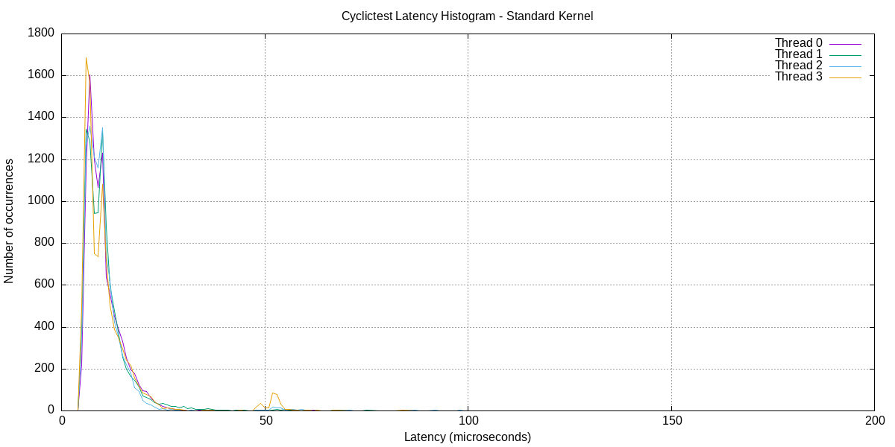

# Lab 03 — Debugging and Performance Analysis

[Về trang chính](../README.md) · [Ứng dụng](apps/) · [Log thực nghiệm](logs/) · [Boot image](output/)

Lab 03 thực hành tìm lỗi chương trình C, phát hiện memory leak, quan sát system call, profiling và đo scheduling latency. Các công cụ được sử dụng gồm **GDB, Valgrind, strace, perf và cyclictest**.

## Nội dung

- [Mục tiêu và môi trường](#mục-tiêu-và-môi-trường)
- [Các file chính](#các-file-chính)
- [Debug bằng GDB](#debug-bằng-gdb)
- [Kiểm tra bộ nhớ với Valgrind](#kiểm-tra-bộ-nhớ-với-valgrind)
- [System call và CPU profiling](#system-call-và-cpu-profiling)
- [Scheduling latency](#scheduling-latency)
- [Bài học rút ra](#bài-học-rút-ra)

## Mục tiêu và môi trường

| Phần | Công cụ | Câu hỏi cần trả lời |
|---|---|---|
| Debugging | GDB / gdb-multiarch | Chương trình sai ở đâu, dữ liệu và stack lúc đó ra sao? |
| Memory analysis | Valgrind Memcheck | Vùng nhớ nào bị mất, đã giải phóng đủ chưa? |
| System-call tracing | strace | Chương trình gọi kernel như thế nào? |
| CPU profiling | perf | Chi phí thực thi tập trung ở đâu? |
| Scheduling | cyclictest | Thread thức dậy lệch bao nhiêu so với lịch? |

HOST là Ubuntu x86_64; target ARM chạy trên QEMU. Các ví dụ dưới đây build **bản HOST** từ source, rồi chạy công cụ trên HOST. Các binary có hậu tố `_arm` phục vụ môi trường ARM và không chạy trực tiếp trên Ubuntu x86_64.

## Các file chính

| File / thư mục | Nội dung |
|---|---|
| [apps/buggy_app.c](apps/buggy_app.c) | Chương trình chứa lỗi truy cập mảng, use-after-free và phép nhân có thể overflow |
| [apps/leaky_app.c](apps/leaky_app.c) | Bản có lỗi giải phóng bộ nhớ |
| [apps/leaky_app_fixed.c](apps/leaky_app_fixed.c) | Bản bổ sung giải phóng dữ liệu và message buffer |
| [apps/perf_target.c](apps/perf_target.c) | Workload tính toán, tìm kiếm và I/O |
| [logs/](logs/) | Kết quả công cụ được lưu trong quá trình làm bài |
| [output/initramfs_lab3.cpio.gz](output/initramfs_lab3.cpio.gz) | Initramfs của Lab 03 |

## Debug bằng GDB

Từ thư mục `embedded_lab3` trên HOST:

```bash
gcc -g -O0 apps/buggy_app.c -o /tmp/lab3_buggy
gdb /tmp/lab3_buggy
```

Trong GDB:

```gdb
break process_data
run
print len
print *data@5
next
backtrace
```

Source giữ các lỗi để phục vụ debug:

| Vị trí | Vấn đề cần phân tích |
|---|---|
| `process_data` | Điều kiện `i <= len` đọc thêm phần tử ngoài mảng |
| `create_message` | Trả con trỏ sau khi vùng nhớ đã được `free` |
| `calculate` | Nhân hai `int` lớn có thể gây signed integer overflow |

Giá trị in ra khi chương trình có undefined behavior không phải kết quả đáng tin cậy. Việc debug cần dựa vào source, chỉ số, địa chỉ và backtrace, thay vì chỉ nhìn một lần chạy không crash.

**Bằng chứng:** [Phiên GDB đã lưu](logs/gdb_session.txt).

## Kiểm tra bộ nhớ với Valgrind

```bash
gcc -g -O0 apps/leaky_app.c -o /tmp/lab3_leaky
gcc -g -O0 apps/leaky_app_fixed.c -o /tmp/lab3_fixed

valgrind --leak-check=full --show-leak-kinds=all /tmp/lab3_leaky
valgrind --leak-check=full --show-leak-kinds=all /tmp/lab3_fixed
```

### So sánh kết quả đã ghi nhận

| Chỉ số | Bản ban đầu | Bản sửa |
|---|---:|---:|
| Tổng alloc | 352 | 352 |
| Tổng free | 102 | 352 |
| Bộ nhớ còn tại exit | 16.900 byte / 250 block | 0 byte / 0 block |
| Memcheck error summary | 3 lỗi / 3 context | 0 lỗi / 0 context |

Trong bản ban đầu, ba nhóm `definitely lost` là 2.000 byte, 2.100 byte và 12.800 byte. Bản sửa giải phóng `name`, `scores`, đối tượng `Record` và buffer tạo trong vòng lặp xử lý message.

**Log gốc:** [Trước khi sửa](logs/valgrind_report.txt) · [Sau khi sửa](logs/valgrind_fixed.txt).

Kết quả 0 lỗi áp dụng cho phiên đã chạy. Source bản sửa vẫn có thể cải thiện thêm việc kiểm tra `malloc` thất bại; Memcheck không thay thế cho kiểm tra mọi đường xử lý lỗi.

## System call và CPU profiling

```bash
gcc -g -O2 apps/perf_target.c -o /tmp/lab3_perf
strace -c /tmp/lab3_perf
perf stat /tmp/lab3_perf
perf record -g -o /tmp/lab3_perf.data /tmp/lab3_perf
perf report -i /tmp/lab3_perf.data
```

`strace -c` tổng hợp syscall; `perf stat` đọc performance counter; `perf record/report` lấy mẫu để xem vị trí tiêu tốn tài nguyên. Quyền truy cập perf phụ thuộc cấu hình HOST. Khi gặp lỗi quyền, kiểm tra thông báo và cấu hình của máy trước khi so sánh kết quả.

Trong [perf_stat.txt](logs/perf_stat.txt), workload được ghi nhận chạy khoảng **0,02356 giây**, với **104.712.852 cycles** và **375.723.714 instructions**. Đây là kết quả của phiên cụ thể; workload ngắn và môi trường HOST có thể ảnh hưởng mạnh khi chạy lại.

**Bằng chứng:** [strace summary](logs/strace_summary.txt) · [strace đầy đủ](logs/strace_full.txt) · [perf stat](logs/perf_stat.txt) · [perf report](logs/perf_report.txt).

## Scheduling latency

Ví dụ chạy cyclictest trên HOST có cài rt-tests:

```bash
sudo cyclictest --mlockall --threads=4 --priority=80 \
    --interval=1000 --loops=10000
```

Lệnh trên là hướng dẫn chạy lại; cấu hình của phiên gốc cần đối chiếu với [log đã lưu](logs/cyclictest_standard.txt). Bốn dòng cuối log lần lượt ghi:

| Thread | Min (µs) | Avg (µs) | Max quan sát (µs) |
|---:|---:|---:|---:|
| 0 | 4 | 10 | 1187 |
| 1 | 4 | 11 | 1556 |
| 2 | 4 | 10 | 962 |
| 3 | 4 | 11 | 1045 |

Hai thread đầu ghi cycle count 9998 và 9999 ở dòng cuối; hai thread sau ghi 10000. Bảng giữ đúng giá trị cuối log, không coi mọi thread đã hoàn thành đúng cùng số vòng.



**Dữ liệu:** [cyclictest](logs/cyclictest_standard.txt) · [Histogram gốc](logs/hist_standard.txt).

Max quan sát là độ trễ lớn nhất trong phiên đo, không phải một giới hạn worst-case đã được chứng minh. Không suy ra có PREEMPT_RT chỉ từ việc thread chạy priority 80.

## Bài học rút ra

- GDB giúp nối biểu hiện bên ngoài với dòng code và dữ liệu gây lỗi.
- Quyền sở hữu cấp phát phải bao gồm cả thành viên con trỏ bên trong struct.
- Chọn công cụ theo câu hỏi: memory leak, syscall, CPU hotspot và scheduling latency là những vấn đề khác nhau.
- Lưu log trước/sau sửa giúp kết luận có căn cứ hơn một ảnh thông báo thành công.
- Những kỹ năng này được áp dụng tiếp trong [Asgn2](../Asgn2/README.md) để debug pipeline đa luồng, kiểm tra shutdown và phân tích jitter.
